# Cấu trúc dữ liệu trên Lark (giải mã giai đoạn 1)

Sinh bằng `scripts/lark/giai-ma.mjs` và `scripts/lark/render-schema.mjs` lúc 2026-11-09T13:01:16.462Z. Chỉ có cấu trúc và số bản ghi; không có nội dung bản ghi nào của học viên (tri thức 05). Các giá trị trong bộ lọc view bị thay bằng `<giá trị>`; lựa chọn của trường có tên giống dữ liệu cá nhân không được in.

Diễn giải nghiệp vụ, mâu thuẫn và đề xuất ánh xạ: [quy-tac-nghiep-vu.md](quy-tac-nghiep-vu.md).

## Base "Quản lý CLB Cờ vua Dương Sinh"

- Token: `V7DHb5fvQaqnrGsH6fFlysuJgme`, múi giờ `Asia/Bangkok`, quyền nâng cao: bật.
- App đọc được 25 bảng. Base không có cờ "bắt buộc" ở mức trường; cột "Bắt buộc" dưới đây lấy từ câu hỏi bắt buộc của biểu mẫu (form view), ô trống là không bắt buộc.
- **Không đọc được** `tblZUIXmpdt13j4x`: quyền nâng cao của Base không cấp cho app (`1254302 The role has no permissions`). Cấu trúc **chưa giải mã**, không đoán.
- **Không đọc được** `tblHp1PGPz52eZBz`: quyền nâng cao của Base không cấp cho app (`1254302 The role has no permissions`). Cấu trúc **chưa giải mã**, không đoán.
- **Không đọc được** `tblwsn0VJepwqi2q`: bảng không còn tồn tại (`1254041 TableIdNotFound`), liên kết cũ còn sót. Cấu trúc **chưa giải mã**, không đoán.
- Automation/workflow: API trả lỗi `1254200` (Something went wrong. Please contact technical support at ht…), chưa liệt kê được. Dashboard: 0. Vai trò quyền nâng cao: API trả lỗi `99992402`.

### Sơ đồ quan hệ

```mermaid
erDiagram
  T1["Từng lần phát sách"]
  T2["HocVien"]
  T3["Sách"]
  T4["Tương tác PH"]
  T5["tblZUIXmpdt13j4x (không đọc được)"]
  T6["Level"]
  T7["tblHp1PGPz52eZBz (không đọc được)"]
  T8["Bài học"]
  T9["2024 Nhận xét mỗi buổi"]
  T10["LopHoc"]
  T11["GiaoVien"]
  T12["2025 Nhận xét mỗi buổi"]
  T13["Biên bản ghi chép ván cờ"]
  T14["Nick Lichess - chesskid"]
  T15["Kết quả từng ván trong giải"]
  T16["Tham gia giải đấu"]
  T17["Tên giải đấu"]
  T18["Task Team EDU"]
  T19["tblwsn0VJepwqi2q (không đọc được)"]
  T20["Team cùng Học tập"]
  T21["Lưu trữ - QL công việc (mẫu cũ)"]
  T1 }o--o{ T2 : "Tên học sinh"
  T1 }o--o| T3 : "Sách dùng"
  T1 }o--o| T1 : "Các mục mẹ 2"
  T4 }o--o| T5 : "Tên PH tương tác"
  T2 }o--o{ T5 : "ID contact PH"
  T2 }o--o| T6 : "Trình độ ban đầu"
  T2 }o--o{ T6 : "Các trình độ đã học tại CLB"
  T2 }o--o| T6 : "Trình độ hiện tại"
  T2 }o--o{ T7 : "Tổng hợp các lần nộp tiền"
  T2 }o--o| T7 : "Lần nộp tiền gần nhất"
  T2 }o--o{ T3 : "Sách đã học"
  T2 }o--o{ T3 : "Sách đang học"
  T2 }o--o{ T5 : "PhuHuynh-Tên con số 1 Copy"
  T8 }o--o{ T3 : "trong Sách"
  T9 }o--o| T2 : "Tên HS"
  T9 }o--o| T7 : "Ký hiệu Lần nộp tiền"
  T9 }o--o| T10 : "Lớp"
  T9 }o--o{ T11 : "GV phụ trách"
  T9 }o--o{ T3 : "Sách đang học"
  T9 }o--o{ T3 : "Sách đã học xong"
  T12 }o--o| T2 : "Tên HS"
  T12 }o--o| T7 : "Ký hiệu Lần nộp tiền"
  T12 }o--o| T10 : "Lớp"
  T12 }o--o{ T11 : "GV phụ trách"
  T12 }o--o{ T3 : "Sách đang học"
  T12 }o--o{ T3 : "Sách đã học xong"
  T12 }o--o| T12 : "Các mục mẹ 7"
  T13 }o--o| T2 : "VĐV 1"
  T13 }o--o| T2 : "VĐV 2"
  T14 }o--o{ T2 : "Tên học viên trong Base"
  T15 }o--o| T16 : "Tên vđv tham gia giải đấu"
  T15 }o--o| T17 : "Tên giải đấu 2"
  T15 }o--o| T17 : "Tên giải đấu 3"
  T16 }o--o| T2 : "Tên HS"
  T16 }o--o{ T17 : "Tên giải tham gia"
  T18 }o--o| T19 : "Parent items"
  T20 }o--o| T20 : "Parent items"
  T21 }o--o| T21 : "Task cha"
  T21 }o--o| T21 : "Các mục mẹ 2"
```



### Danh sách bảng

| Bảng                             | Id                 | Số bản ghi | Số trường | View                                                                                                                                               |
| -------------------------------- | ------------------ | ---------: | --------: | -------------------------------------------------------------------------------------------------------------------------------------------------- |
| Từng lần phát sách               | `tblU8nwesckl40Ff` |        338 |        10 | Grid (grid), học sinh (grid), Tên học sinh KL (grid), Tên học sinh VP (grid), filter tên HS (grid), Grid_vewnoIkdbo (grid)                         |
| Tương tác PH                     | `tblHOPEfTzxCU2ff` |         13 |         8 | Lưới (grid), Tương tác theo PH (grid), Tương tác theo HS (grid), Chủ đề (grid), Tình trạng xử lý (kanban), Biểu mẫu (form), Lưới_vew3fksh19 (grid) |
| LopHoc                           | `tblKvdbs97cDCMF9` |          7 |         6 | Lưới (grid), Lưới_vewT8gRePA (grid)                                                                                                                |
| HocVien                          | `tblv524wVlgIsH5H` |        179 |        36 | Lưới (grid), Cơ sở Kim Liên (grid), Đang học (grid), Lưới_vewYLM8Xo4 (grid)                                                                        |
| GiaoVien                         | `tblmBDJ8bQSMqpNB` |         17 |        25 | Lưới (grid), Lưới_vewzQic7DG (grid)                                                                                                                |
| Level                            | `tblvjJoqGcHsoxQr` |         12 |         5 | Grid (grid)                                                                                                                                        |
| Sách                             | `tbl324dOlvbf3BUu` |         37 |         5 | Lưới (grid)                                                                                                                                        |
| Bài học                          | `tblG4aQinbihceyz` |         10 |         6 | Lưới (grid)                                                                                                                                        |
| 2024 Nhận xét mỗi buổi           | `tblprrzroE2NBli5` |        723 |        23 | Lưới (grid), xem HS (grid), Ngày (grid), Học sinh (grid), Kim Liên (grid), Sort theo cơ sở ba tháng cuối (grid)                                    |
| 2025 Nhận xét mỗi buổi           | `tbluhrY4B8i63PAh` |       2525 |        24 | Lưới (grid), xem HS (grid), Ngày-Lớp (grid), Học sinh (grid), Sort theo cơ sở (grid), Vĩnh Phúc (grid), filter học sinh (grid)                     |
| Đánh giá định kỳ 5 buổi một      | `tblUYIRX3QK1h8Re` |         10 |         5 | Grid (grid)                                                                                                                                        |
| Cuối năm 2024 - nhận xét định kỳ | `tblI5iaKQeRMkmyl` |         52 |        17 | Cuối năm 2024 (grid)                                                                                                                               |
| Biên bản ghi chép ván cờ         | `tblgbmORJJZkiggZ` |          2 |         6 | Grid (grid)                                                                                                                                        |
| Nick Lichess - chesskid          | `tbldSIbTMvu5VyOc` |          5 |         6 | Grid (grid), Form (form)                                                                                                                           |
| Tên giải đấu                     | `tblePpRFUXMaE793` |         10 |         5 | Grid (grid)                                                                                                                                        |
| Tổng điểm cộng dồn từng VĐV      | `tblelHnYNZT676pM` |         17 |         3 | Grid (grid)                                                                                                                                        |
| Kết quả từng ván trong giải      | `tblnFVeycdwaEccU` |         71 |         8 | Grid (grid), Form (form), Lọc theo từng HS (grid), Grid 3 (grid)                                                                                   |
| Tham gia giải đấu                | `tblh5OYrWqGweKW1` |         17 |         7 | Grid (grid)                                                                                                                                        |
| Cách tính điểm                   | `tblzXUTxriafQzoe` |         10 |         6 | Grid (grid)                                                                                                                                        |
| Team meeting                     | `tblY1of0cxywTYAA` |         24 |        22 | Grid (grid)                                                                                                                                        |
| Task Team EDU                    | `tbl3XOLmPKS5fZFc` |         15 |        21 | Grid (grid)                                                                                                                                        |
| Task Team ADMIN                  | `tblYPNL6AW2SSXwI` |          1 |        22 | Grid (grid)                                                                                                                                        |
| Task Team EVENT                  | `tblkHh7c1pNAuW1D` |          4 |        23 | Grid (grid)                                                                                                                                        |
| Team cùng Học tập                | `tbl3ut6MmVP7NmV3` |         41 |         6 | Grid (grid), Thư viện (gallery)                                                                                                                    |
| Lưu trữ - QL công việc (mẫu cũ)  | `tblNnu2Pvno44xlm` |         35 |        21 | Lưới (grid), Gantt (gantt)                                                                                                                         |

### Từng lần phát sách

`tblU8nwesckl40Ff` · 338 bản ghi · trường chính (primary) là trường đánh dấu ★.

| Trường                  | Loại         | Bắt buộc | Chi tiết                                                                                                                                                                                                                                                                                                                                         |
| ----------------------- | ------------ | -------- | ------------------------------------------------------------------------------------------------------------------------------------------------------------------------------------------------------------------------------------------------------------------------------------------------------------------------------------------------ |
| ★ Ký hiệu lần phát sách | Text         |          |                                                                                                                                                                                                                                                                                                                                                  |
| Cơ sở                   | SingleSelect |          | lựa chọn: `Kim Liên`, `Vĩnh Phúc`                                                                                                                                                                                                                                                                                                                |
| Tên học sinh            | SingleLink   |          | → **HocVien** (nhiều)                                                                                                                                                                                                                                                                                                                            |
| Ngày dùng               | DateTime     |          | định dạng `dd/MM/yyyy`                                                                                                                                                                                                                                                                                                                           |
| Sách dùng               | SingleLink   |          | → **Sách** (một)                                                                                                                                                                                                                                                                                                                                 |
| Giá                     | Lookup       |          | tra cứu **Sách**.Giá bán cho PH<br>`bitable::$table[tbl324dOlvbf3BUu].FILTER(CurrentValue.$column[fldpeCUdJR].CONTAIN(bitable::$table[tblU8nwesckl40Ff].$field[fldIwjW4X0])).$column[fldlT5cC9q].LISTCOMBINE()`<br>đọc là: `[Sách].FILTER(CurrentValue.[Ký hiệu sách].CONTAIN([Từng lần phát sách].[Sách dùng])).[Giá bán cho PH].LISTCOMBINE()` |
| Ưu đãi                  | Number       |          |                                                                                                                                                                                                                                                                                                                                                  |
| Tiền sách               | Formula      |          | `bitable::$table[tblU8nwesckl40Ff].$field[fldndaHE4l]-bitable::$table[tblU8nwesckl40Ff].$field[fldjP2J1fR]`<br>đọc là: `[Từng lần phát sách].[Giá]-[Từng lần phát sách].[Ưu đãi]`                                                                                                                                                                |
| Ghi chú                 | Text         |          |                                                                                                                                                                                                                                                                                                                                                  |
| Các mục mẹ 2            | SingleLink   |          | → **Từng lần phát sách** (một)                                                                                                                                                                                                                                                                                                                   |

View có bộ lọc: "Tên học sinh KL": Cơ sở is <giá trị>; "Tên học sinh VP": Cơ sở is <giá trị>.

### Tương tác PH

`tblHOPEfTzxCU2ff` · 13 bản ghi · trường chính (primary) là trường đánh dấu ★.

| Trường            | Loại        | Bắt buộc | Chi tiết                                                                                                                                                                                                                                                                                                                                                       |
| ----------------- | ----------- | -------- | -------------------------------------------------------------------------------------------------------------------------------------------------------------------------------------------------------------------------------------------------------------------------------------------------------------------------------------------------------------- |
| ★ Mô tả tương tác | Text        |          |                                                                                                                                                                                                                                                                                                                                                                |
| Ngày tương tác    | DateTime    |          | định dạng `dd/MM/yyyy`                                                                                                                                                                                                                                                                                                                                         |
| Chủ đề            | MultiSelect |          | lựa chọn: `lịch học cố định`, `đặc điểm HS`, `nghỉ học`, `nhắc mang sách`, `Nhắc nộp HP`, `Nhắc học trở lại`                                                                                                                                                                                                                                                   |
| Tên PH tương tác  | SingleLink  |          | → **tblZUIXmpdt13j4x (không đọc được)** (một)                                                                                                                                                                                                                                                                                                                  |
| Tên HS            | Lookup      |          | tra cứu **tblZUIXmpdt13j4x (không đọc được)**.fld1EEysvi<br>`bitable::$table[tblZUIXmpdt13j4x].FILTER(CurrentValue.$column[fld6W8Uuwl]=bitable::$table[tblHOPEfTzxCU2ff].$field[fldgdL638B]).$column[fld1EEysvi].LISTCOMBINE()`<br>đọc là: `[tblZUIXmpdt13j4x].FILTER(CurrentValue.[fld6W8Uuwl]=[Tương tác PH].[Tên PH tương tác]).[fld1EEysvi].LISTCOMBINE()` |
| Ảnh lưu tương tác | Attachment  |          |                                                                                                                                                                                                                                                                                                                                                                |
| Tình trạng xử lý  | Stage       |          |                                                                                                                                                                                                                                                                                                                                                                |
| Ghi chú           | Text        |          |                                                                                                                                                                                                                                                                                                                                                                |

### LopHoc

`tblKvdbs97cDCMF9` · 7 bản ghi · trường chính (primary) là trường đánh dấu ★.

| Trường            | Loại         | Bắt buộc | Chi tiết                                                                |
| ----------------- | ------------ | -------- | ----------------------------------------------------------------------- |
| ★ Tên lớp         | Text         |          |                                                                         |
| cơ sở             | SingleSelect |          | lựa chọn: `Kim Liên`, `Vĩnh Phúc`                                       |
| Thứ               | SingleSelect |          | lựa chọn: `Thứ 2`, `Thứ 3`, `Thứ 5`, `Thứ 6`, `Thứ 7`                   |
| Ca dạy            | SingleSelect |          | lựa chọn: `Ca2 (19h15-20h30)`, `Ca1 (18h15-19h15)`, `Ca2 (19h30-20h45)` |
| GV Phụ trách      | User         |          |                                                                         |
| Thời gian bắt đầu | DateTime     |          | định dạng `yyyy/MM/dd HH:mm`                                            |

### HocVien

`tblv524wVlgIsH5H` · 179 bản ghi · trường chính (primary) là trường đánh dấu ★.

| Trường                                 | Loại         | Bắt buộc | Chi tiết                                                                                                                                                                                                                                                                                                                                                       |
| -------------------------------------- | ------------ | -------- | -------------------------------------------------------------------------------------------------------------------------------------------------------------------------------------------------------------------------------------------------------------------------------------------------------------------------------------------------------------- |
| ★ Học viên                             | Text         |          |                                                                                                                                                                                                                                                                                                                                                                |
| ID Học viên                            | AutoNumber   |          | mã tự tăng: HV-<created_time:yyyyMMdd>-<system_number:3>                                                                                                                                                                                                                                                                                                       |
| Nickname                               | Text         |          |                                                                                                                                                                                                                                                                                                                                                                |
| Ngày sinh                              | DateTime     |          | định dạng `dd/MM/yyyy`                                                                                                                                                                                                                                                                                                                                         |
| Nhắc sinh nhật                         | Formula      |          | `IF(AND(MONTH(bitable::$table[tblv524wVlgIsH5H].$field[fld722sUfQ])=MONTH(TODAY()), DAY(bitable::$table[tblv524wVlgIsH5H].$field[fld722sUfQ])=DAY(TODAY())), "Hôm nay sinh nhật", "")`<br>đọc là: `IF(AND(MONTH([HocVien].[Ngày sinh])=MONTH(TODAY()), DAY([HocVien].[Ngày sinh])=DAY(TODAY())), "Hôm nay sinh nhật", "")`                                     |
| email PH                               | Text         |          |                                                                                                                                                                                                                                                                                                                                                                |
| Mã định danh (CCCD)                    | Number       |          |                                                                                                                                                                                                                                                                                                                                                                |
| Giới tính                              | SingleSelect |          | lựa chọn: `Nam`, `Nữ`                                                                                                                                                                                                                                                                                                                                          |
| cơ sở                                  | SingleSelect |          | lựa chọn: `Kim Liên`, `Vĩnh Phúc`                                                                                                                                                                                                                                                                                                                              |
| Tình trạng học                         | SingleSelect |          | lựa chọn: `Đang học`, `Đã nghỉ`, `Tạm nghỉ`, `Mới học thử`, `Đăng ký học thử`, `Chưa học thử`                                                                                                                                                                                                                                                                  |
| ID contact PH                          | DuplexLink   |          | → **tblZUIXmpdt13j4x (không đọc được)** (nhiều)                                                                                                                                                                                                                                                                                                                |
| Họ tên PH                              | Lookup       |          | tra cứu **tblZUIXmpdt13j4x (không đọc được)**.fldCyV9C6F<br>`bitable::$table[tblZUIXmpdt13j4x].FILTER(CurrentValue.$column[fld6W8Uuwl]=bitable::$table[tblv524wVlgIsH5H].$field[fldZxY5XcI]).$column[fldCyV9C6F].LISTCOMBINE()`<br>đọc là: `[tblZUIXmpdt13j4x].FILTER(CurrentValue.[fld6W8Uuwl]=[HocVien].[ID contact PH]).[fldCyV9C6F].LISTCOMBINE()`         |
| Quan hệ                                | SingleSelect |          | lựa chọn: `Mẹ`, `Bố`, `Ông/ Bà`                                                                                                                                                                                                                                                                                                                                |
| Địa chỉ hóa đơn                        | Text         |          |                                                                                                                                                                                                                                                                                                                                                                |
| Địa chỉ nơi ở                          | Lookup       |          | tra cứu **tblZUIXmpdt13j4x (không đọc được)**.fldq03LG65<br>`bitable::$table[tblZUIXmpdt13j4x].FILTER(CurrentValue.$column[fld6W8Uuwl]=bitable::$table[tblv524wVlgIsH5H].$field[fldZxY5XcI]).$column[fldq03LG65].LISTCOMBINE()`<br>đọc là: `[tblZUIXmpdt13j4x].FILTER(CurrentValue.[fld6W8Uuwl]=[HocVien].[ID contact PH]).[fldq03LG65].LISTCOMBINE()`         |
| SDT PH                                 | Lookup       |          | tra cứu **tblZUIXmpdt13j4x (không đọc được)**.fldGZHpThh<br>`bitable::$table[tblZUIXmpdt13j4x].FILTER(CurrentValue.$column[fld6W8Uuwl]=bitable::$table[tblv524wVlgIsH5H].$field[fldZxY5XcI]).$column[fldGZHpThh].LISTCOMBINE()`<br>đọc là: `[tblZUIXmpdt13j4x].FILTER(CurrentValue.[fld6W8Uuwl]=[HocVien].[ID contact PH]).[fldGZHpThh].LISTCOMBINE()`         |
| Tên Trường học                         | Text         |          |                                                                                                                                                                                                                                                                                                                                                                |
| Lớp                                    | Text         |          |                                                                                                                                                                                                                                                                                                                                                                |
| Sở thích                               | Text         |          |                                                                                                                                                                                                                                                                                                                                                                |
| Mong muốn khi học cờ                   | Text         |          |                                                                                                                                                                                                                                                                                                                                                                |
| Test đầu vào (dạng ảnh)                | Attachment   |          |                                                                                                                                                                                                                                                                                                                                                                |
| Test đầu vào (dạng test)               | Text         |          |                                                                                                                                                                                                                                                                                                                                                                |
| Test đầu vào (dạng Link) Copy          | Url          |          |                                                                                                                                                                                                                                                                                                                                                                |
| Ảnh buổi đầu                           | Attachment   |          |                                                                                                                                                                                                                                                                                                                                                                |
| Trình độ ban đầu                       | SingleLink   |          | → **Level** (một)                                                                                                                                                                                                                                                                                                                                              |
| Những kiến thức còn thiếu ở Nhập môn   | Text         |          |                                                                                                                                                                                                                                                                                                                                                                |
| Các trình độ đã học tại CLB            | SingleLink   |          | → **Level** (nhiều)                                                                                                                                                                                                                                                                                                                                            |
| Trình độ hiện tại                      | SingleLink   |          | → **Level** (một)                                                                                                                                                                                                                                                                                                                                              |
| Tổng hợp các lần nộp tiền              | SingleLink   |          | → **tblHp1PGPz52eZBz (không đọc được)** (nhiều)                                                                                                                                                                                                                                                                                                                |
| Lần nộp tiền gần nhất                  | SingleLink   |          | → **tblHp1PGPz52eZBz (không đọc được)** (một)                                                                                                                                                                                                                                                                                                                  |
| số buổi tồn update (vào ngày thống kê) | Lookup       |          | tra cứu **tblHp1PGPz52eZBz (không đọc được)**.fldBCMdh5j<br>`bitable::$table[tblHp1PGPz52eZBz].FILTER(CurrentValue.$column[fld40HQwi0]=bitable::$table[tblv524wVlgIsH5H].$field[fldjYsHAdJ]).$column[fldBCMdh5j].LISTCOMBINE()`<br>đọc là: `[tblHp1PGPz52eZBz].FILTER(CurrentValue.[fld40HQwi0]=[HocVien].[Lần nộp tiền gần nhất]).[fldBCMdh5j].LISTCOMBINE()` |
| Ngày update gần nhất về HP             | DateTime     |          | định dạng `dd/MM/yyyy`                                                                                                                                                                                                                                                                                                                                         |
| Sách đã học                            | SingleLink   |          | → **Sách** (nhiều)                                                                                                                                                                                                                                                                                                                                             |
| Sách đang học                          | SingleLink   |          | → **Sách** (nhiều)                                                                                                                                                                                                                                                                                                                                             |
| Ghi chú                                | Text         |          |                                                                                                                                                                                                                                                                                                                                                                |
| PhuHuynh-Tên con số 1 Copy             | DuplexLink   |          | → **tblZUIXmpdt13j4x (không đọc được)** (nhiều)                                                                                                                                                                                                                                                                                                                |

View có bộ lọc: "Lưới": Học viên contains <giá trị>; "Cơ sở Kim Liên": cơ sở is <giá trị>; "Đang học": Tình trạng học is <giá trị>.

### GiaoVien

`tblmBDJ8bQSMqpNB` · 17 bản ghi · trường chính (primary) là trường đánh dấu ★.

| Trường                    | Loại     | Bắt buộc | Chi tiết                                                                                                                                                                                                                                                                                                                     |
| ------------------------- | -------- | -------- | ---------------------------------------------------------------------------------------------------------------------------------------------------------------------------------------------------------------------------------------------------------------------------------------------------------------------------- |
| ★ Ten_tat                 | Text     |          |                                                                                                                                                                                                                                                                                                                              |
| Ho_ten                    | Text     |          |                                                                                                                                                                                                                                                                                                                              |
| Ngày sinh                 | DateTime |          | định dạng `dd/MM/yyyy`                                                                                                                                                                                                                                                                                                       |
| Nhắc ngày sinh nhật       | Formula  |          | `IF(AND(MONTH(bitable::$table[tblmBDJ8bQSMqpNB].$field[fldEIqnfY5])=MONTH(TODAY()), DAY(bitable::$table[tblmBDJ8bQSMqpNB].$field[fldEIqnfY5])=DAY(TODAY())), "Hôm nay sinh nhật", "")`<br>đọc là: `IF(AND(MONTH([GiaoVien].[Ngày sinh])=MONTH(TODAY()), DAY([GiaoVien].[Ngày sinh])=DAY(TODAY())), "Hôm nay sinh nhật", "")` |
| SDT                       | Number   |          |                                                                                                                                                                                                                                                                                                                              |
| email                     | Text     |          |                                                                                                                                                                                                                                                                                                                              |
| Bank                      | Text     |          |                                                                                                                                                                                                                                                                                                                              |
| Vị trí / Vai trò          | Text     |          |                                                                                                                                                                                                                                                                                                                              |
| Thù lao mỗi buổi          | Text     |          |                                                                                                                                                                                                                                                                                                                              |
| Tình trạng làm việc       | Text     |          |                                                                                                                                                                                                                                                                                                                              |
| Elo cờ vua                | Number   |          |                                                                                                                                                                                                                                                                                                                              |
| Email cá nhân             | Text     |          |                                                                                                                                                                                                                                                                                                                              |
| Quê quán                  | Text     |          |                                                                                                                                                                                                                                                                                                                              |
| Trường ĐH                 | Text     |          |                                                                                                                                                                                                                                                                                                                              |
| Ngành học                 | Text     |          |                                                                                                                                                                                                                                                                                                                              |
| Thành tích cờ             | Text     |          |                                                                                                                                                                                                                                                                                                                              |
| Kỹ năng / điểm mạnh       | Text     |          |                                                                                                                                                                                                                                                                                                                              |
| Sở thích                  | Text     |          |                                                                                                                                                                                                                                                                                                                              |
| Định hướng nghề (ghi chú) | Text     |          |                                                                                                                                                                                                                                                                                                                              |
| Kinh nghiệm / hoạt động   | Text     |          |                                                                                                                                                                                                                                                                                                                              |
| Kinh nghiệm giảng dạy     | Text     |          |                                                                                                                                                                                                                                                                                                                              |
| Ghi chú (XM)              | Text     |          |                                                                                                                                                                                                                                                                                                                              |
| Facebook                  | Text     |          |                                                                                                                                                                                                                                                                                                                              |
| Địa chỉ hiện tại          | Text     |          |                                                                                                                                                                                                                                                                                                                              |
| Trống - chưa dùng         | Text     |          |                                                                                                                                                                                                                                                                                                                              |

### Level

`tblvjJoqGcHsoxQr` · 12 bản ghi · trường chính (primary) là trường đánh dấu ★.

| Trường               | Loại         | Bắt buộc | Chi tiết               |
| -------------------- | ------------ | -------- | ---------------------- |
| ★ Tên viết tắt level | Text         |          |                        |
| Person               | User         |          |                        |
| Single Option        | SingleSelect |          | lựa chọn: (trống)      |
| Date                 | DateTime     |          | định dạng `yyyy/MM/dd` |
| Attachment           | Attachment   |          |                        |

### Sách

`tbl324dOlvbf3BUu` · 37 bản ghi · trường chính (primary) là trường đánh dấu ★.

| Trường                | Loại   | Bắt buộc | Chi tiết |
| --------------------- | ------ | -------- | -------- |
| ★ Ký hiệu sách        | Text   |          |          |
| Tên sách              | Text   |          |          |
| Giá bìa               | Number |          |          |
| Giá bán cho PH        | Number |          |          |
| Trình độ / ND tóm tắt | Text   |          |          |

### Bài học

`tblG4aQinbihceyz` · 10 bản ghi · trường chính (primary) là trường đánh dấu ★.

| Trường            | Loại       | Bắt buộc | Chi tiết           |
| ----------------- | ---------- | -------- | ------------------ |
| ★ Ký hiệu bài học | Text       |          |                    |
| Tên bài học       | Text       |          |                    |
| trong Sách        | SingleLink |          | → **Sách** (nhiều) |
| Số trang mở đầu   | Number     |          |                    |
| Số trang kết thúc | Number     |          |                    |
| Ghi chú           | Text       |          |                    |

### 2024 Nhận xét mỗi buổi

`tblprrzroE2NBli5` · 723 bản ghi · trường chính (primary) là trường đánh dấu ★.

| Trường                    | Loại         | Bắt buộc | Chi tiết                                                                                                                                                                                                                                                                                                                                                       |
| ------------------------- | ------------ | -------- | -------------------------------------------------------------------------------------------------------------------------------------------------------------------------------------------------------------------------------------------------------------------------------------------------------------------------------------------------------------- |
| ★ Ngày học                | Text         |          |                                                                                                                                                                                                                                                                                                                                                                |
| Ngày học - Day format     | DateTime     |          | định dạng `dd/MM/yyyy`                                                                                                                                                                                                                                                                                                                                         |
| Tháng                     | Formula      |          | `MONTH(bitable::$table[tblprrzroE2NBli5].$field[fldyNL90SQ])`<br>đọc là: `MONTH([2024 Nhận xét mỗi buổi].[Ngày học - Day format])`                                                                                                                                                                                                                             |
| Năm                       | Formula      |          | `YEAR(bitable::$table[tblprrzroE2NBli5].$field[fldyNL90SQ])`<br>đọc là: `YEAR([2024 Nhận xét mỗi buổi].[Ngày học - Day format])`                                                                                                                                                                                                                               |
| Tên HS                    | SingleLink   |          | → **HocVien** (một)                                                                                                                                                                                                                                                                                                                                            |
| Ký hiệu Lần nộp tiền      | SingleLink   |          | → **tblHp1PGPz52eZBz (không đọc được)** (một)                                                                                                                                                                                                                                                                                                                  |
| cơ sở                     | Lookup       |          | tra cứu **HocVien**.cơ sở<br>`bitable::$table[tblv524wVlgIsH5H].FILTER(CurrentValue.$column[fldFvAKHD0]=bitable::$table[tblprrzroE2NBli5].$field[fldH4YODgl]).$column[fldNM0Gyb6].LISTCOMBINE()`<br>đọc là: `[HocVien].FILTER(CurrentValue.[Học viên]=[2024 Nhận xét mỗi buổi].[Tên HS]).[cơ sở].LISTCOMBINE()`                                                |
| Lớp                       | SingleLink   |          | → **LopHoc** (một)                                                                                                                                                                                                                                                                                                                                             |
| có mặt                    | SingleSelect |          | lựa chọn: `1`, `0`, `học lớp 2`, `FALSE`, `Quyên`, `Huy`, `Tường`                                                                                                                                                                                                                                                                                              |
| GV phụ trách              | SingleLink   |          | → **GiaoVien** (nhiều)                                                                                                                                                                                                                                                                                                                                         |
| Kế hoạch dạy              | Text         |          |                                                                                                                                                                                                                                                                                                                                                                |
| Làm BTVN                  | Number       |          |                                                                                                                                                                                                                                                                                                                                                                |
| Ý thức                    | Number       |          |                                                                                                                                                                                                                                                                                                                                                                |
| Kiến thức / lý thuyết mới | Text         |          |                                                                                                                                                                                                                                                                                                                                                                |
| Nhận xét                  | Text         |          |                                                                                                                                                                                                                                                                                                                                                                |
| Giao BTVN                 | Text         |          |                                                                                                                                                                                                                                                                                                                                                                |
| KH buổi sau               | Text         |          |                                                                                                                                                                                                                                                                                                                                                                |
| Sách đang học             | SingleLink   |          | → **Sách** (nhiều)                                                                                                                                                                                                                                                                                                                                             |
| Ghi chú                   | Text         |          |                                                                                                                                                                                                                                                                                                                                                                |
| Link lichess              | Url          |          |                                                                                                                                                                                                                                                                                                                                                                |
| Sách đã học xong          | SingleLink   |          | → **Sách** (nhiều)                                                                                                                                                                                                                                                                                                                                             |
| Tổng số buổi              | Lookup       |          | tra cứu **tblHp1PGPz52eZBz (không đọc được)**.fldHfG75tb<br>`bitable::$table[tblHp1PGPz52eZBz].FILTER(CurrentValue.$column[fldeLNzRvl]=bitable::$table[tblprrzroE2NBli5].$field[fldH4YODgl]).$column[fldHfG75tb].LISTCOMBINE()`<br>đọc là: `[tblHp1PGPz52eZBz].FILTER(CurrentValue.[fldeLNzRvl]=[2024 Nhận xét mỗi buổi].[Tên HS]).[fldHfG75tb].LISTCOMBINE()` |
| Số buổi còn lại           | Text         |          |                                                                                                                                                                                                                                                                                                                                                                |

View có bộ lọc: "Học sinh": Tên HS is <giá trị>; "Kim Liên": Ngày học is; "Sort theo cơ sở ba tháng cuối": Tháng is <giá trị> HOẶC Tháng is <giá trị> HOẶC Tháng is <giá trị>.

### 2025 Nhận xét mỗi buổi

`tbluhrY4B8i63PAh` · 2525 bản ghi · trường chính (primary) là trường đánh dấu ★.

| Trường                    | Loại       | Bắt buộc | Chi tiết                                                                                                                                                                                                                                                                                                                                                       |
| ------------------------- | ---------- | -------- | -------------------------------------------------------------------------------------------------------------------------------------------------------------------------------------------------------------------------------------------------------------------------------------------------------------------------------------------------------------- |
| ★ Ngày học                | Text       |          |                                                                                                                                                                                                                                                                                                                                                                |
| Ngày học - Day format     | DateTime   |          | định dạng `dd/MM/yyyy`                                                                                                                                                                                                                                                                                                                                         |
| Tháng                     | Formula    |          | `MONTH(bitable::$table[tbluhrY4B8i63PAh].$field[fldyNL90SQ])`<br>đọc là: `MONTH([2025 Nhận xét mỗi buổi].[Ngày học - Day format])`                                                                                                                                                                                                                             |
| Năm                       | Formula    |          | `YEAR(bitable::$table[tbluhrY4B8i63PAh].$field[fldyNL90SQ])`<br>đọc là: `YEAR([2025 Nhận xét mỗi buổi].[Ngày học - Day format])`                                                                                                                                                                                                                               |
| Tên HS                    | SingleLink |          | → **HocVien** (một)                                                                                                                                                                                                                                                                                                                                            |
| Ký hiệu Lần nộp tiền      | SingleLink |          | → **tblHp1PGPz52eZBz (không đọc được)** (một)                                                                                                                                                                                                                                                                                                                  |
| cơ sở                     | Lookup     |          | tra cứu **HocVien**.cơ sở<br>`bitable::$table[tblv524wVlgIsH5H].FILTER(CurrentValue.$column[fldFvAKHD0]=bitable::$table[tbluhrY4B8i63PAh].$field[fldH4YODgl]).$column[fldNM0Gyb6].LISTCOMBINE()`<br>đọc là: `[HocVien].FILTER(CurrentValue.[Học viên]=[2025 Nhận xét mỗi buổi].[Tên HS]).[cơ sở].LISTCOMBINE()`                                                |
| Lớp                       | SingleLink |          | → **LopHoc** (một)                                                                                                                                                                                                                                                                                                                                             |
| có mặt                    | Number     |          |                                                                                                                                                                                                                                                                                                                                                                |
| GV phụ trách              | SingleLink |          | → **GiaoVien** (nhiều)                                                                                                                                                                                                                                                                                                                                         |
| Kế hoạch dạy              | Text       |          |                                                                                                                                                                                                                                                                                                                                                                |
| Làm BTVN                  | Number     |          |                                                                                                                                                                                                                                                                                                                                                                |
| Ý thức                    | Number     |          |                                                                                                                                                                                                                                                                                                                                                                |
| Kiến thức / lý thuyết mới | Text       |          |                                                                                                                                                                                                                                                                                                                                                                |
| Nhận xét                  | Text       |          |                                                                                                                                                                                                                                                                                                                                                                |
| Giao BTVN                 | Text       |          |                                                                                                                                                                                                                                                                                                                                                                |
| KH buổi sau               | Text       |          |                                                                                                                                                                                                                                                                                                                                                                |
| Sách đang học             | SingleLink |          | → **Sách** (nhiều)                                                                                                                                                                                                                                                                                                                                             |
| Ghi chú                   | Text       |          |                                                                                                                                                                                                                                                                                                                                                                |
| Link lichess              | Text       |          |                                                                                                                                                                                                                                                                                                                                                                |
| Sách đã học xong          | SingleLink |          | → **Sách** (nhiều)                                                                                                                                                                                                                                                                                                                                             |
| Tổng số buổi              | Lookup     |          | tra cứu **tblHp1PGPz52eZBz (không đọc được)**.fldHfG75tb<br>`bitable::$table[tblHp1PGPz52eZBz].FILTER(CurrentValue.$column[fldeLNzRvl]=bitable::$table[tbluhrY4B8i63PAh].$field[fldH4YODgl]).$column[fldHfG75tb].LISTCOMBINE()`<br>đọc là: `[tblHp1PGPz52eZBz].FILTER(CurrentValue.[fldeLNzRvl]=[2025 Nhận xét mỗi buổi].[Tên HS]).[fldHfG75tb].LISTCOMBINE()` |
| Số buổi còn lại           | Text       |          |                                                                                                                                                                                                                                                                                                                                                                |
| Các mục mẹ 7              | SingleLink |          | → **2025 Nhận xét mỗi buổi** (một)                                                                                                                                                                                                                                                                                                                             |

View có bộ lọc: "Học sinh": Tên HS is <giá trị>; "Sort theo cơ sở": Ngày học is; "Vĩnh Phúc": cơ sở is <giá trị>.

### Đánh giá định kỳ 5 buổi một

`tblUYIRX3QK1h8Re` · 10 bản ghi · trường chính (primary) là trường đánh dấu ★.

| Trường        | Loại         | Bắt buộc | Chi tiết               |
| ------------- | ------------ | -------- | ---------------------- |
| ★ Text        | Text         |          |                        |
| Person        | User         |          |                        |
| Single Option | SingleSelect |          | lựa chọn: (trống)      |
| Date          | DateTime     |          | định dạng `yyyy/MM/dd` |
| Attachment    | Attachment   |          |                        |

### Cuối năm 2024 - nhận xét định kỳ

`tblI5iaKQeRMkmyl` · 52 bản ghi · trường chính (primary) là trường đánh dấu ★.

| Trường                                                                    | Loại   | Bắt buộc | Chi tiết |
| ------------------------------------------------------------------------- | ------ | -------- | -------- |
| ★ TT                                                                      | Number |          |          |
| Họ tên                                                                    | Text   |          |          |
| Cơ sở                                                                     | Text   |          |          |
| Level                                                                     | Text   |          |          |
| GV phụ trách                                                              | Text   |          |          |
| Ý thức học tập                                                            | Number |          |          |
| BTVN                                                                      | Text   |          |          |
| Tham gia giải đấu                                                         | Text   |          |          |
| Các sách đã học                                                           | Text   |          |          |
| Nhận xét chung (khai; trung; tàn; chiến thuật; chiến lược; ưu; nhược ...) | Text   |          |          |
| Kế hoạch thời gian tới                                                    | Text   |          |          |
| Ghi chú                                                                   | Text   |          |          |
| UnknownName                                                               | Text   |          |          |
| UnknownName_1                                                             | Text   |          |          |
| UnknownName_2                                                             | Text   |          |          |
| UnknownName_3                                                             | Text   |          |          |
| SourceID                                                                  | Text   |          |          |

### Biên bản ghi chép ván cờ

`tblgbmORJJZkiggZ` · 2 bản ghi · trường chính (primary) là trường đánh dấu ★.

| Trường            | Loại       | Bắt buộc | Chi tiết                                                 |
| ----------------- | ---------- | -------- | -------------------------------------------------------- |
| ★ ID Biên bản     | AutoNumber |          | mã tự tăng: BB-<created_time:yyyyMMdd>-<system_number:3> |
| VĐV 1             | SingleLink |          | → **HocVien** (một)                                      |
| VĐV 2             | SingleLink |          | → **HocVien** (một)                                      |
| Ngày đấu          | DateTime   |          | định dạng `dd/MM/yyyy`                                   |
| Ảnh chụp Biên bản | Attachment |          |                                                          |
| Ghi chú           | Text       |          |                                                          |

### Nick Lichess - chesskid

`tbldSIbTMvu5VyOc` · 5 bản ghi · trường chính (primary) là trường đánh dấu ★.

| Trường                  | Loại        | Bắt buộc             | Chi tiết                                           |
| ----------------------- | ----------- | -------------------- | -------------------------------------------------- |
| ★ ID                    | Text        |                      |                                                    |
| Tên học viên            | Text        | Có (biểu mẫu "Form") |                                                    |
| Tên học viên trong Base | SingleLink  |                      | → **HocVien** (nhiều)                              |
| Tên nền tảng            | MultiSelect | Có (biểu mẫu "Form") | 2 lựa chọn (không in vì có thể là dữ liệu cá nhân) |
| Tên Nick                | Text        | Có (biểu mẫu "Form") |                                                    |
| Link                    | Url         |                      |                                                    |

### Tên giải đấu

`tblePpRFUXMaE793` · 10 bản ghi · trường chính (primary) là trường đánh dấu ★.

| Trường        | Loại         | Bắt buộc | Chi tiết               |
| ------------- | ------------ | -------- | ---------------------- |
| ★ Tên giải    | Text         |          |                        |
| Person        | User         |          |                        |
| Single Option | SingleSelect |          | lựa chọn: (trống)      |
| Date          | DateTime     |          | định dạng `yyyy/MM/dd` |
| Attachment    | Attachment   |          |                        |

### Tổng điểm cộng dồn từng VĐV

`tblelHnYNZT676pM` · 17 bản ghi · trường chính (primary) là trường đánh dấu ★.

| Trường      | Loại   | Bắt buộc | Chi tiết                                                                                                                                                                                                                                                                                                                                                                                                                                 |
| ----------- | ------ | -------- | ---------------------------------------------------------------------------------------------------------------------------------------------------------------------------------------------------------------------------------------------------------------------------------------------------------------------------------------------------------------------------------------------------------------------------------------- |
| ★ ID Kỳ thủ | Text   |          |                                                                                                                                                                                                                                                                                                                                                                                                                                          |
| Tên HS      | Lookup |          | tra cứu **Tham gia giải đấu**.Tên HS<br>`bitable::$table[tblh5OYrWqGweKW1].FILTER(CurrentValue.$column[fldLG0iLWd]=bitable::$table[tblelHnYNZT676pM].$field[fldW1DAsb9]).$column[fldvPuSCvN].LISTCOMBINE()`<br>đọc là: `[Tham gia giải đấu].FILTER(CurrentValue.[ID HS đấu giải]=[Tổng điểm cộng dồn từng VĐV].[ID Kỳ thủ]).[Tên HS].LISTCOMBINE()`                                                                                      |
| Tổng điểm   | Lookup |          | tra cứu **Kết quả từng ván trong giải**.Đạt số điểm là (gộp: tính tổng/tổng hợp)<br>`bitable::$table[tblnFVeycdwaEccU].FILTER(CurrentValue.$column[fldZTgMeli]=bitable::$table[tblelHnYNZT676pM].$field[fldW1DAsb9]).$column[fldmz4KmVE].LISTCOMBINE().SUM()`<br>đọc là: `[Kết quả từng ván trong giải].FILTER(CurrentValue.[Tên vđv tham gia giải đấu]=[Tổng điểm cộng dồn từng VĐV].[ID Kỳ thủ]).[Đạt số điểm là].LISTCOMBINE().SUM()` |

### Kết quả từng ván trong giải

`tblnFVeycdwaEccU` · 71 bản ghi · trường chính (primary) là trường đánh dấu ★.

| Trường                    | Loại         | Bắt buộc             | Chi tiết                                                                                                                                                                                                                                                                                                                                                               |
| ------------------------- | ------------ | -------------------- | ---------------------------------------------------------------------------------------------------------------------------------------------------------------------------------------------------------------------------------------------------------------------------------------------------------------------------------------------------------------------- |
| ★ ID Kết quả              | Text         |                      |                                                                                                                                                                                                                                                                                                                                                                        |
| Tên vđv tham gia giải đấu | SingleLink   | Có (biểu mẫu "Form") | → **Tham gia giải đấu** (một)                                                                                                                                                                                                                                                                                                                                          |
| Tên HS                    | Lookup       |                      | tra cứu **Tham gia giải đấu**.Tên HS<br>`bitable::$table[tblh5OYrWqGweKW1].FILTER(CurrentValue.$column[fldLG0iLWd]=bitable::$table[tblnFVeycdwaEccU].$field[fldZTgMeli]).$column[fldvPuSCvN].LISTCOMBINE()`<br>đọc là: `[Tham gia giải đấu].FILTER(CurrentValue.[ID HS đấu giải]=[Kết quả từng ván trong giải].[Tên vđv tham gia giải đấu]).[Tên HS].LISTCOMBINE()`    |
| Ván số mấy                | SingleSelect | Có (biểu mẫu "Form") | lựa chọn: `Ván 1`, `Ván 2`, `Ván 3`, `Ván 4`, `Ván 5`, `Ván 6`, `Ván 7`, `Ván 8`, `Ván 9`, `Ván 10`                                                                                                                                                                                                                                                                    |
| Kết quả ván               | SingleSelect | Có (biểu mẫu "Form") | lựa chọn: `Thắng`, `Hòa`, `Thua`                                                                                                                                                                                                                                                                                                                                       |
| Đạt số điểm là            | Lookup       |                      | tra cứu **Cách tính điểm**.Cách tính điểm số<br>`bitable::$table[tblzXUTxriafQzoe].FILTER(CurrentValue.$column[fldKiQjJqT]=bitable::$table[tblnFVeycdwaEccU].$field[flddfdcdvl]).$column[fldv6tFOvF].LISTCOMBINE()`<br>đọc là: `[Cách tính điểm].FILTER(CurrentValue.[Kết quả ván đấu]=[Kết quả từng ván trong giải].[Kết quả ván]).[Cách tính điểm số].LISTCOMBINE()` |
| Tên giải đấu 2            | SingleLink   |                      | → **Tên giải đấu** (một)                                                                                                                                                                                                                                                                                                                                               |
| Tên giải đấu 3            | SingleLink   | Có (biểu mẫu "Form") | → **Tên giải đấu** (một)                                                                                                                                                                                                                                                                                                                                               |

### Tham gia giải đấu

`tblh5OYrWqGweKW1` · 17 bản ghi · trường chính (primary) là trường đánh dấu ★.

| Trường            | Loại         | Bắt buộc | Chi tiết                   |
| ----------------- | ------------ | -------- | -------------------------- |
| ★ ID HS đấu giải  | Text         |          |                            |
| Tên HS            | SingleLink   |          | → **HocVien** (một)        |
| Tên giải tham gia | SingleLink   |          | → **Tên giải đấu** (nhiều) |
| Person            | User         |          |                            |
| Single Option     | SingleSelect |          | lựa chọn: (trống)          |
| Date              | DateTime     |          | định dạng `yyyy/MM/dd`     |
| Attachment        | Attachment   |          |                            |

### Cách tính điểm

`tblzXUTxriafQzoe` · 10 bản ghi · trường chính (primary) là trường đánh dấu ★.

| Trường            | Loại         | Bắt buộc | Chi tiết               |
| ----------------- | ------------ | -------- | ---------------------- |
| ★ Kết quả ván đấu | Text         |          |                        |
| Cách tính điểm số | Number       |          |                        |
| Person            | User         |          |                        |
| Single Option     | SingleSelect |          | lựa chọn: (trống)      |
| Date              | DateTime     |          | định dạng `yyyy/MM/dd` |
| Attachment        | Attachment   |          |                        |

### Team meeting

`tblY1of0cxywTYAA` · 24 bản ghi · trường chính (primary) là trường đánh dấu ★.

| Trường            | Loại         | Bắt buộc | Chi tiết                                                                                                                                                                                                                                                                                                                                                                                                                                                                                                                                                                                                                                                                                                                                                                                                                                                                                                                                                                                                                                                                                                      |
| ----------------- | ------------ | -------- | ------------------------------------------------------------------------------------------------------------------------------------------------------------------------------------------------------------------------------------------------------------------------------------------------------------------------------------------------------------------------------------------------------------------------------------------------------------------------------------------------------------------------------------------------------------------------------------------------------------------------------------------------------------------------------------------------------------------------------------------------------------------------------------------------------------------------------------------------------------------------------------------------------------------------------------------------------------------------------------------------------------------------------------------------------------------------------------------------------------- |
| ★ Task ID         | Text         |          |                                                                                                                                                                                                                                                                                                                                                                                                                                                                                                                                                                                                                                                                                                                                                                                                                                                                                                                                                                                                                                                                                                               |
| Task Title        | Text         |          |                                                                                                                                                                                                                                                                                                                                                                                                                                                                                                                                                                                                                                                                                                                                                                                                                                                                                                                                                                                                                                                                                                               |
| Plan              | SingleSelect |          | lựa chọn: `Plan 1 (3/3-25/5/2025)`, `Plan 2 (26/5 - 17/8/2025)`, `Plan 3 (18/8 - 9/11/2025)`                                                                                                                                                                                                                                                                                                                                                                                                                                                                                                                                                                                                                                                                                                                                                                                                                                                                                                                                                                                                                  |
| Week              | SingleSelect |          | lựa chọn: `w1`, `w2`, `w3`, `w4`, `w5`, `w6`, `w7`, `w8`, `w9`, `w10`, `w11`, `w12`                                                                                                                                                                                                                                                                                                                                                                                                                                                                                                                                                                                                                                                                                                                                                                                                                                                                                                                                                                                                                           |
| Loại Task         | MultiSelect  |          | lựa chọn: `HS dự giải`, `Giải nội bộ`, `Vận hành đào tạo`, `Quản lý chung`, `Họp Team`, `Việc Team EDU`, `Việc Team MKT`, `Việc Team EVENT`                                                                                                                                                                                                                                                                                                                                                                                                                                                                                                                                                                                                                                                                                                                                                                                                                                                                                                                                                                   |
| Mô tả công việc   | Text         |          |                                                                                                                                                                                                                                                                                                                                                                                                                                                                                                                                                                                                                                                                                                                                                                                                                                                                                                                                                                                                                                                                                                               |
| Báo cáo công việc | Text         |          |                                                                                                                                                                                                                                                                                                                                                                                                                                                                                                                                                                                                                                                                                                                                                                                                                                                                                                                                                                                                                                                                                                               |
| Mức độ ưu tiên    | SingleSelect |          | lựa chọn: `Ko QT - Ko Gấp`, `QT - Gấp`, `QT - Ko Gấp`, `Ko QT - Gấp`                                                                                                                                                                                                                                                                                                                                                                                                                                                                                                                                                                                                                                                                                                                                                                                                                                                                                                                                                                                                                                          |
| Status            | SingleSelect |          | lựa chọn: `Chưa bắt đầu`, `Đang làm`, `Chờ duyệt`, `Đã hoàn thành`, `Trễ`, `Đã hủy`, `Đang lên lịch`                                                                                                                                                                                                                                                                                                                                                                                                                                                                                                                                                                                                                                                                                                                                                                                                                                                                                                                                                                                                          |
| Người liên quan   | User         |          |                                                                                                                                                                                                                                                                                                                                                                                                                                                                                                                                                                                                                                                                                                                                                                                                                                                                                                                                                                                                                                                                                                               |
| Người viết note   | User         |          |                                                                                                                                                                                                                                                                                                                                                                                                                                                                                                                                                                                                                                                                                                                                                                                                                                                                                                                                                                                                                                                                                                               |
| Start date        | DateTime     |          | định dạng `dd/MM/yyyy`                                                                                                                                                                                                                                                                                                                                                                                                                                                                                                                                                                                                                                                                                                                                                                                                                                                                                                                                                                                                                                                                                        |
| End date          | DateTime     |          | định dạng `dd/MM/yyyy`                                                                                                                                                                                                                                                                                                                                                                                                                                                                                                                                                                                                                                                                                                                                                                                                                                                                                                                                                                                                                                                                                        |
| Deadline          | DateTime     |          | định dạng `yyyy/MM/dd HH:mm`                                                                                                                                                                                                                                                                                                                                                                                                                                                                                                                                                                                                                                                                                                                                                                                                                                                                                                                                                                                                                                                                                  |
| Link KQ 1         | Url          |          |                                                                                                                                                                                                                                                                                                                                                                                                                                                                                                                                                                                                                                                                                                                                                                                                                                                                                                                                                                                                                                                                                                               |
| Link KQ 2         | Url          |          |                                                                                                                                                                                                                                                                                                                                                                                                                                                                                                                                                                                                                                                                                                                                                                                                                                                                                                                                                                                                                                                                                                               |
| Link KQ 3         | Url          |          |                                                                                                                                                                                                                                                                                                                                                                                                                                                                                                                                                                                                                                                                                                                                                                                                                                                                                                                                                                                                                                                                                                               |
| Link KQ 4         | Url          |          |                                                                                                                                                                                                                                                                                                                                                                                                                                                                                                                                                                                                                                                                                                                                                                                                                                                                                                                                                                                                                                                                                                               |
| Đính kèm KQ       | Attachment   |          |                                                                                                                                                                                                                                                                                                                                                                                                                                                                                                                                                                                                                                                                                                                                                                                                                                                                                                                                                                                                                                                                                                               |
| Đánh giá          | Number       |          |                                                                                                                                                                                                                                                                                                                                                                                                                                                                                                                                                                                                                                                                                                                                                                                                                                                                                                                                                                                                                                                                                                               |
| Thời gian còn lại | Formula      |          | `IFS(bitable::$table[tblY1of0cxywTYAA].$field[fldcnoz7lj]="","",bitable::$table[tblY1of0cxywTYAA].$field[fldcnoz7lj]-NOW()>0,"Còn lại "&INT(bitable::$table[tblY1of0cxywTYAA].$field[fldcnoz7lj]-NOW())&" ngày "&TEXT(bitable::$table[tblY1of0cxywTYAA].$field[fldcnoz7lj]-NOW()-INT(bitable::$table[tblY1of0cxywTYAA].$field[fldcnoz7lj]-NOW()),"h:mm")&" giờ",bitable::$table[tblY1of0cxywTYAA].$field[fldcnoz7lj]-NOW()<=0,"Đã qua Deadline "&INT(NOW()-bitable::$table[tblY1of0cxywTYAA].$field[fldcnoz7lj])&" ngày "&TEXT(NOW()-bitable::$table[tblY1of0cxywTYAA].$field[fldcnoz7lj]-INT(NOW()-bitable::$table[tblY1of0cxywTYAA].$field[fldcnoz7lj]),"h:mm")&" giờ")`<br>đọc là: `IFS([Team meeting].[Deadline]="","",[Team meeting].[Deadline]-NOW()>0,"Còn lại "&INT([Team meeting].[Deadline]-NOW())&" ngày "&TEXT([Team meeting].[Deadline]-NOW()-INT([Team meeting].[Deadline]-NOW()),"h:mm")&" giờ",[Team meeting].[Deadline]-NOW()<=0,"Đã qua Deadline "&INT(NOW()-[Team meeting].[Deadline])&" ngày "&TEXT(NOW()-[Team meeting].[Deadline]-INT(NOW()-[Team meeting].[Deadline]),"h:mm")&" giờ")` |
| Parent items      | SingleLink   |          |                                                                                                                                                                                                                                                                                                                                                                                                                                                                                                                                                                                                                                                                                                                                                                                                                                                                                                                                                                                                                                                                                                               |

### Task Team EDU

`tbl3XOLmPKS5fZFc` · 15 bản ghi · trường chính (primary) là trường đánh dấu ★.

| Trường            | Loại         | Bắt buộc | Chi tiết                                                                                                                                                                                                                                                                                                                                                                                                                                                                                                                                                                                                                                                                                                                                                                                                                                                                                                                                                                                                                                                                                                               |
| ----------------- | ------------ | -------- | ---------------------------------------------------------------------------------------------------------------------------------------------------------------------------------------------------------------------------------------------------------------------------------------------------------------------------------------------------------------------------------------------------------------------------------------------------------------------------------------------------------------------------------------------------------------------------------------------------------------------------------------------------------------------------------------------------------------------------------------------------------------------------------------------------------------------------------------------------------------------------------------------------------------------------------------------------------------------------------------------------------------------------------------------------------------------------------------------------------------------- |
| ★ Task ID         | Text         |          |                                                                                                                                                                                                                                                                                                                                                                                                                                                                                                                                                                                                                                                                                                                                                                                                                                                                                                                                                                                                                                                                                                                        |
| Task Title        | Text         |          |                                                                                                                                                                                                                                                                                                                                                                                                                                                                                                                                                                                                                                                                                                                                                                                                                                                                                                                                                                                                                                                                                                                        |
| Plan              | SingleSelect |          | lựa chọn: `Plan 1 (3/3-25/5/2025)`, `Plan 2 (26/5 - 3/7/2025)`                                                                                                                                                                                                                                                                                                                                                                                                                                                                                                                                                                                                                                                                                                                                                                                                                                                                                                                                                                                                                                                         |
| Week              | SingleSelect |          | lựa chọn: `w1`, `w2`, `w3`, `w4`, `w5`, `w6`, `w7`, `w8`, `w9`, `w10`, `w11`, `w12`                                                                                                                                                                                                                                                                                                                                                                                                                                                                                                                                                                                                                                                                                                                                                                                                                                                                                                                                                                                                                                    |
| Loại Task         | MultiSelect  |          | lựa chọn: `HS dự giải`, `Giải nội bộ`, `Vận hành đào tạo`, `Quản lý chung`, `Họp Team`, `Việc Team EDU`, `Việc Team MKT`, `Việc Team EVENT`                                                                                                                                                                                                                                                                                                                                                                                                                                                                                                                                                                                                                                                                                                                                                                                                                                                                                                                                                                            |
| Mô tả công việc   | Text         |          |                                                                                                                                                                                                                                                                                                                                                                                                                                                                                                                                                                                                                                                                                                                                                                                                                                                                                                                                                                                                                                                                                                                        |
| Báo cáo công việc | Text         |          |                                                                                                                                                                                                                                                                                                                                                                                                                                                                                                                                                                                                                                                                                                                                                                                                                                                                                                                                                                                                                                                                                                                        |
| Mức độ ưu tiên    | SingleSelect |          | lựa chọn: `Ko QT - Ko Gấp`, `QT - Gấp`, `QT - Ko Gấp`, `Ko QT - Gấp`                                                                                                                                                                                                                                                                                                                                                                                                                                                                                                                                                                                                                                                                                                                                                                                                                                                                                                                                                                                                                                                   |
| Status            | SingleSelect |          | lựa chọn: `Chưa bắt đầu`, `Đang làm`, `Chờ duyệt`, `Đã hoàn thành`, `Trễ`, `Đã hủy`, `Đang lên lịch`                                                                                                                                                                                                                                                                                                                                                                                                                                                                                                                                                                                                                                                                                                                                                                                                                                                                                                                                                                                                                   |
| Người làm         | User         |          |                                                                                                                                                                                                                                                                                                                                                                                                                                                                                                                                                                                                                                                                                                                                                                                                                                                                                                                                                                                                                                                                                                                        |
| Start date        | DateTime     |          | định dạng `dd/MM/yyyy`                                                                                                                                                                                                                                                                                                                                                                                                                                                                                                                                                                                                                                                                                                                                                                                                                                                                                                                                                                                                                                                                                                 |
| End date          | DateTime     |          | định dạng `dd/MM/yyyy`                                                                                                                                                                                                                                                                                                                                                                                                                                                                                                                                                                                                                                                                                                                                                                                                                                                                                                                                                                                                                                                                                                 |
| Deadline          | DateTime     |          | định dạng `yyyy/MM/dd HH:mm`                                                                                                                                                                                                                                                                                                                                                                                                                                                                                                                                                                                                                                                                                                                                                                                                                                                                                                                                                                                                                                                                                           |
| Link KQ 1         | Url          |          |                                                                                                                                                                                                                                                                                                                                                                                                                                                                                                                                                                                                                                                                                                                                                                                                                                                                                                                                                                                                                                                                                                                        |
| Link KQ 2         | Url          |          |                                                                                                                                                                                                                                                                                                                                                                                                                                                                                                                                                                                                                                                                                                                                                                                                                                                                                                                                                                                                                                                                                                                        |
| Link KQ 3         | Url          |          |                                                                                                                                                                                                                                                                                                                                                                                                                                                                                                                                                                                                                                                                                                                                                                                                                                                                                                                                                                                                                                                                                                                        |
| Link KQ 4         | Url          |          |                                                                                                                                                                                                                                                                                                                                                                                                                                                                                                                                                                                                                                                                                                                                                                                                                                                                                                                                                                                                                                                                                                                        |
| Đính kèm KQ       | Attachment   |          |                                                                                                                                                                                                                                                                                                                                                                                                                                                                                                                                                                                                                                                                                                                                                                                                                                                                                                                                                                                                                                                                                                                        |
| Đánh giá          | Number       |          |                                                                                                                                                                                                                                                                                                                                                                                                                                                                                                                                                                                                                                                                                                                                                                                                                                                                                                                                                                                                                                                                                                                        |
| Thời gian còn lại | Formula      |          | `IFS(bitable::$table[tbl3XOLmPKS5fZFc].$field[fldcnoz7lj]="","",bitable::$table[tbl3XOLmPKS5fZFc].$field[fldcnoz7lj]-NOW()>0,"Còn lại "&INT(bitable::$table[tbl3XOLmPKS5fZFc].$field[fldcnoz7lj]-NOW())&" ngày "&TEXT(bitable::$table[tbl3XOLmPKS5fZFc].$field[fldcnoz7lj]-NOW()-INT(bitable::$table[tbl3XOLmPKS5fZFc].$field[fldcnoz7lj]-NOW()),"h:mm")&" giờ",bitable::$table[tbl3XOLmPKS5fZFc].$field[fldcnoz7lj]-NOW()<=0,"Đã qua Deadline "&INT(NOW()-bitable::$table[tbl3XOLmPKS5fZFc].$field[fldcnoz7lj])&" ngày "&TEXT(NOW()-bitable::$table[tbl3XOLmPKS5fZFc].$field[fldcnoz7lj]-INT(NOW()-bitable::$table[tbl3XOLmPKS5fZFc].$field[fldcnoz7lj]),"h:mm")&" giờ")`<br>đọc là: `IFS([Task Team EDU].[Deadline]="","",[Task Team EDU].[Deadline]-NOW()>0,"Còn lại "&INT([Task Team EDU].[Deadline]-NOW())&" ngày "&TEXT([Task Team EDU].[Deadline]-NOW()-INT([Task Team EDU].[Deadline]-NOW()),"h:mm")&" giờ",[Task Team EDU].[Deadline]-NOW()<=0,"Đã qua Deadline "&INT(NOW()-[Task Team EDU].[Deadline])&" ngày "&TEXT(NOW()-[Task Team EDU].[Deadline]-INT(NOW()-[Task Team EDU].[Deadline]),"h:mm")&" giờ")` |
| Parent items      | SingleLink   |          | → **tblwsn0VJepwqi2q (không đọc được)** (một)                                                                                                                                                                                                                                                                                                                                                                                                                                                                                                                                                                                                                                                                                                                                                                                                                                                                                                                                                                                                                                                                          |

### Task Team ADMIN

`tblYPNL6AW2SSXwI` · 1 bản ghi · trường chính (primary) là trường đánh dấu ★.

| Trường            | Loại         | Bắt buộc | Chi tiết                                                                                                                                                                                                                                                                                                                                                                                                                                                                                                                                                                                                                                                                                                                                                                                                                                                                                                                                                                                                                                                                                                                                 |
| ----------------- | ------------ | -------- | ---------------------------------------------------------------------------------------------------------------------------------------------------------------------------------------------------------------------------------------------------------------------------------------------------------------------------------------------------------------------------------------------------------------------------------------------------------------------------------------------------------------------------------------------------------------------------------------------------------------------------------------------------------------------------------------------------------------------------------------------------------------------------------------------------------------------------------------------------------------------------------------------------------------------------------------------------------------------------------------------------------------------------------------------------------------------------------------------------------------------------------------- |
| ★ Task ID         | Text         |          |                                                                                                                                                                                                                                                                                                                                                                                                                                                                                                                                                                                                                                                                                                                                                                                                                                                                                                                                                                                                                                                                                                                                          |
| Task Title        | Text         |          |                                                                                                                                                                                                                                                                                                                                                                                                                                                                                                                                                                                                                                                                                                                                                                                                                                                                                                                                                                                                                                                                                                                                          |
| Plan              | SingleSelect |          | lựa chọn: `Plan 1 (3/3-25/5/2025)`, `Plan 2 (26/5 - 3/7/2025)`                                                                                                                                                                                                                                                                                                                                                                                                                                                                                                                                                                                                                                                                                                                                                                                                                                                                                                                                                                                                                                                                           |
| Week              | SingleSelect |          | lựa chọn: `w1`, `w2`, `w3`, `w4`, `w5`, `w6`, `w7`, `w8`, `w9`, `w10`, `w11`, `w12`                                                                                                                                                                                                                                                                                                                                                                                                                                                                                                                                                                                                                                                                                                                                                                                                                                                                                                                                                                                                                                                      |
| Loại Task         | MultiSelect  |          | lựa chọn: `HS dự giải`, `Giải nội bộ`, `Vận hành đào tạo`, `Quản lý chung`, `Họp Team`, `Việc Team EDU`, `Việc Team MKT`, `Việc Team EVENT`                                                                                                                                                                                                                                                                                                                                                                                                                                                                                                                                                                                                                                                                                                                                                                                                                                                                                                                                                                                              |
| Mô tả công việc   | Text         |          |                                                                                                                                                                                                                                                                                                                                                                                                                                                                                                                                                                                                                                                                                                                                                                                                                                                                                                                                                                                                                                                                                                                                          |
| Báo cáo công việc | Text         |          |                                                                                                                                                                                                                                                                                                                                                                                                                                                                                                                                                                                                                                                                                                                                                                                                                                                                                                                                                                                                                                                                                                                                          |
| Mức độ ưu tiên    | SingleSelect |          | lựa chọn: `Ko QT - Ko Gấp`, `QT - Gấp`, `QT - Ko Gấp`, `Ko QT - Gấp`                                                                                                                                                                                                                                                                                                                                                                                                                                                                                                                                                                                                                                                                                                                                                                                                                                                                                                                                                                                                                                                                     |
| Status            | SingleSelect |          | lựa chọn: `Chưa bắt đầu`, `Đang làm`, `Chờ duyệt`, `Đã hoàn thành`, `Trễ`, `Đã hủy`, `Đang lên lịch`                                                                                                                                                                                                                                                                                                                                                                                                                                                                                                                                                                                                                                                                                                                                                                                                                                                                                                                                                                                                                                     |
| Người làm         | User         |          |                                                                                                                                                                                                                                                                                                                                                                                                                                                                                                                                                                                                                                                                                                                                                                                                                                                                                                                                                                                                                                                                                                                                          |
| Người note        | User         |          |                                                                                                                                                                                                                                                                                                                                                                                                                                                                                                                                                                                                                                                                                                                                                                                                                                                                                                                                                                                                                                                                                                                                          |
| Start date        | DateTime     |          | định dạng `dd/MM/yyyy`                                                                                                                                                                                                                                                                                                                                                                                                                                                                                                                                                                                                                                                                                                                                                                                                                                                                                                                                                                                                                                                                                                                   |
| End date          | DateTime     |          | định dạng `dd/MM/yyyy`                                                                                                                                                                                                                                                                                                                                                                                                                                                                                                                                                                                                                                                                                                                                                                                                                                                                                                                                                                                                                                                                                                                   |
| Deadline          | DateTime     |          | định dạng `yyyy/MM/dd HH:mm`                                                                                                                                                                                                                                                                                                                                                                                                                                                                                                                                                                                                                                                                                                                                                                                                                                                                                                                                                                                                                                                                                                             |
| Link KQ 1         | Url          |          |                                                                                                                                                                                                                                                                                                                                                                                                                                                                                                                                                                                                                                                                                                                                                                                                                                                                                                                                                                                                                                                                                                                                          |
| Link KQ 2         | Url          |          |                                                                                                                                                                                                                                                                                                                                                                                                                                                                                                                                                                                                                                                                                                                                                                                                                                                                                                                                                                                                                                                                                                                                          |
| Link KQ 3         | Url          |          |                                                                                                                                                                                                                                                                                                                                                                                                                                                                                                                                                                                                                                                                                                                                                                                                                                                                                                                                                                                                                                                                                                                                          |
| Link KQ 4         | Url          |          |                                                                                                                                                                                                                                                                                                                                                                                                                                                                                                                                                                                                                                                                                                                                                                                                                                                                                                                                                                                                                                                                                                                                          |
| Đính kèm KQ       | Attachment   |          |                                                                                                                                                                                                                                                                                                                                                                                                                                                                                                                                                                                                                                                                                                                                                                                                                                                                                                                                                                                                                                                                                                                                          |
| Đánh giá          | Number       |          |                                                                                                                                                                                                                                                                                                                                                                                                                                                                                                                                                                                                                                                                                                                                                                                                                                                                                                                                                                                                                                                                                                                                          |
| Thời gian còn lại | Formula      |          | `IFS(bitable::$table[tblYPNL6AW2SSXwI].$field[fldcnoz7lj]="","",bitable::$table[tblYPNL6AW2SSXwI].$field[fldcnoz7lj]-NOW()>0,"Còn lại "&INT(bitable::$table[tblYPNL6AW2SSXwI].$field[fldcnoz7lj]-NOW())&" ngày "&TEXT(bitable::$table[tblYPNL6AW2SSXwI].$field[fldcnoz7lj]-NOW()-INT(bitable::$table[tblYPNL6AW2SSXwI].$field[fldcnoz7lj]-NOW()),"h:mm")&" giờ",bitable::$table[tblYPNL6AW2SSXwI].$field[fldcnoz7lj]-NOW()<=0,"Đã qua Deadline "&INT(NOW()-bitable::$table[tblYPNL6AW2SSXwI].$field[fldcnoz7lj])&" ngày "&TEXT(NOW()-bitable::$table[tblYPNL6AW2SSXwI].$field[fldcnoz7lj]-INT(NOW()-bitable::$table[tblYPNL6AW2SSXwI].$field[fldcnoz7lj]),"h:mm")&" giờ")`<br>đọc là: `IFS([Task Team ADMIN].[Deadline]="","",[Task Team ADMIN].[Deadline]-NOW()>0,"Còn lại "&INT([Task Team ADMIN].[Deadline]-NOW())&" ngày "&TEXT([Task Team ADMIN].[Deadline]-NOW()-INT([Task Team ADMIN].[Deadline]-NOW()),"h:mm")&" giờ",[Task Team ADMIN].[Deadline]-NOW()<=0,"Đã qua Deadline "&INT(NOW()-[Task Team ADMIN].[Deadline])&" ngày "&TEXT(NOW()-[Task Team ADMIN].[Deadline]-INT(NOW()-[Task Team ADMIN].[Deadline]),"h:mm")&" giờ")` |
| Parent items      | SingleLink   |          |                                                                                                                                                                                                                                                                                                                                                                                                                                                                                                                                                                                                                                                                                                                                                                                                                                                                                                                                                                                                                                                                                                                                          |

### Task Team EVENT

`tblkHh7c1pNAuW1D` · 4 bản ghi · trường chính (primary) là trường đánh dấu ★.

| Trường              | Loại         | Bắt buộc | Chi tiết                                                                                                                                                                                                                                                                                                                                                                                                                                                                                                                                                                                                                                                                                                                                                                                                                                                                                                                                                                                                                                                                                                                                 |
| ------------------- | ------------ | -------- | ---------------------------------------------------------------------------------------------------------------------------------------------------------------------------------------------------------------------------------------------------------------------------------------------------------------------------------------------------------------------------------------------------------------------------------------------------------------------------------------------------------------------------------------------------------------------------------------------------------------------------------------------------------------------------------------------------------------------------------------------------------------------------------------------------------------------------------------------------------------------------------------------------------------------------------------------------------------------------------------------------------------------------------------------------------------------------------------------------------------------------------------- |
| ★ Task ID           | Text         |          |                                                                                                                                                                                                                                                                                                                                                                                                                                                                                                                                                                                                                                                                                                                                                                                                                                                                                                                                                                                                                                                                                                                                          |
| Task Title          | Text         |          |                                                                                                                                                                                                                                                                                                                                                                                                                                                                                                                                                                                                                                                                                                                                                                                                                                                                                                                                                                                                                                                                                                                                          |
| Plan                | SingleSelect |          | lựa chọn: `Plan 1 (3/3-25/5/2025)`, `Plan 2 (26/5 - 3/7/2025)`                                                                                                                                                                                                                                                                                                                                                                                                                                                                                                                                                                                                                                                                                                                                                                                                                                                                                                                                                                                                                                                                           |
| Week                | SingleSelect |          | lựa chọn: `w1`, `w2`, `w3`, `w4`, `w5`, `w6`, `w7`, `w8`, `w9`, `w10`, `w11`, `w12`                                                                                                                                                                                                                                                                                                                                                                                                                                                                                                                                                                                                                                                                                                                                                                                                                                                                                                                                                                                                                                                      |
| Team                | MultiSelect  |          | lựa chọn: `Team EDU`, `Team EVENT`, `Team MKT`, `ALL Team`                                                                                                                                                                                                                                                                                                                                                                                                                                                                                                                                                                                                                                                                                                                                                                                                                                                                                                                                                                                                                                                                               |
| Loại Task           | MultiSelect  |          | lựa chọn: `HS dự giải`, `Giải nội bộ`, `Vận hành đào tạo`, `Quản lý chung`, `Họp Team`, `Việc Team EDU`, `Việc Team MKT`, `Việc Team EVENT`                                                                                                                                                                                                                                                                                                                                                                                                                                                                                                                                                                                                                                                                                                                                                                                                                                                                                                                                                                                              |
| Mô tả công việc     | Text         |          |                                                                                                                                                                                                                                                                                                                                                                                                                                                                                                                                                                                                                                                                                                                                                                                                                                                                                                                                                                                                                                                                                                                                          |
| Phòng ban được giao | MultiSelect  |          | lựa chọn: `EDU`, `Team`, `EVENT`, `MKT`, `Admin`, `CSKH`, `Sale KD`, `R&D`, `Giám đốc`, `Tài chính`, `Brand`, `Pháp chế`, `Công nghệ`                                                                                                                                                                                                                                                                                                                                                                                                                                                                                                                                                                                                                                                                                                                                                                                                                                                                                                                                                                                                    |
| Báo cáo công việc   | Text         |          |                                                                                                                                                                                                                                                                                                                                                                                                                                                                                                                                                                                                                                                                                                                                                                                                                                                                                                                                                                                                                                                                                                                                          |
| Mức độ ưu tiên      | SingleSelect |          | lựa chọn: `Ko QT - Ko Gấp`, `QT - Gấp`, `QT - Ko Gấp`, `Ko QT - Gấp`                                                                                                                                                                                                                                                                                                                                                                                                                                                                                                                                                                                                                                                                                                                                                                                                                                                                                                                                                                                                                                                                     |
| Status              | SingleSelect |          | lựa chọn: `Chưa bắt đầu`, `Đang làm`, `Chờ duyệt`, `Đã hoàn thành`, `Trễ`, `Đã hủy`, `Đang lên lịch`                                                                                                                                                                                                                                                                                                                                                                                                                                                                                                                                                                                                                                                                                                                                                                                                                                                                                                                                                                                                                                     |
| Người làm           | User         |          |                                                                                                                                                                                                                                                                                                                                                                                                                                                                                                                                                                                                                                                                                                                                                                                                                                                                                                                                                                                                                                                                                                                                          |
| Start date          | DateTime     |          | định dạng `dd/MM/yyyy`                                                                                                                                                                                                                                                                                                                                                                                                                                                                                                                                                                                                                                                                                                                                                                                                                                                                                                                                                                                                                                                                                                                   |
| End date            | DateTime     |          | định dạng `dd/MM/yyyy`                                                                                                                                                                                                                                                                                                                                                                                                                                                                                                                                                                                                                                                                                                                                                                                                                                                                                                                                                                                                                                                                                                                   |
| Deadline            | DateTime     |          | định dạng `yyyy/MM/dd HH:mm`                                                                                                                                                                                                                                                                                                                                                                                                                                                                                                                                                                                                                                                                                                                                                                                                                                                                                                                                                                                                                                                                                                             |
| Link KQ 1           | Url          |          |                                                                                                                                                                                                                                                                                                                                                                                                                                                                                                                                                                                                                                                                                                                                                                                                                                                                                                                                                                                                                                                                                                                                          |
| Link KQ 2           | Url          |          |                                                                                                                                                                                                                                                                                                                                                                                                                                                                                                                                                                                                                                                                                                                                                                                                                                                                                                                                                                                                                                                                                                                                          |
| Link KQ 3           | Url          |          |                                                                                                                                                                                                                                                                                                                                                                                                                                                                                                                                                                                                                                                                                                                                                                                                                                                                                                                                                                                                                                                                                                                                          |
| Link KQ 4           | Url          |          |                                                                                                                                                                                                                                                                                                                                                                                                                                                                                                                                                                                                                                                                                                                                                                                                                                                                                                                                                                                                                                                                                                                                          |
| Đính kèm KQ         | Attachment   |          |                                                                                                                                                                                                                                                                                                                                                                                                                                                                                                                                                                                                                                                                                                                                                                                                                                                                                                                                                                                                                                                                                                                                          |
| Đánh giá            | Number       |          |                                                                                                                                                                                                                                                                                                                                                                                                                                                                                                                                                                                                                                                                                                                                                                                                                                                                                                                                                                                                                                                                                                                                          |
| Thời gian còn lại   | Formula      |          | `IFS(bitable::$table[tblkHh7c1pNAuW1D].$field[fldcnoz7lj]="","",bitable::$table[tblkHh7c1pNAuW1D].$field[fldcnoz7lj]-NOW()>0,"Còn lại "&INT(bitable::$table[tblkHh7c1pNAuW1D].$field[fldcnoz7lj]-NOW())&" ngày "&TEXT(bitable::$table[tblkHh7c1pNAuW1D].$field[fldcnoz7lj]-NOW()-INT(bitable::$table[tblkHh7c1pNAuW1D].$field[fldcnoz7lj]-NOW()),"h:mm")&" giờ",bitable::$table[tblkHh7c1pNAuW1D].$field[fldcnoz7lj]-NOW()<=0,"Đã qua Deadline "&INT(NOW()-bitable::$table[tblkHh7c1pNAuW1D].$field[fldcnoz7lj])&" ngày "&TEXT(NOW()-bitable::$table[tblkHh7c1pNAuW1D].$field[fldcnoz7lj]-INT(NOW()-bitable::$table[tblkHh7c1pNAuW1D].$field[fldcnoz7lj]),"h:mm")&" giờ")`<br>đọc là: `IFS([Task Team EVENT].[Deadline]="","",[Task Team EVENT].[Deadline]-NOW()>0,"Còn lại "&INT([Task Team EVENT].[Deadline]-NOW())&" ngày "&TEXT([Task Team EVENT].[Deadline]-NOW()-INT([Task Team EVENT].[Deadline]-NOW()),"h:mm")&" giờ",[Task Team EVENT].[Deadline]-NOW()<=0,"Đã qua Deadline "&INT(NOW()-[Task Team EVENT].[Deadline])&" ngày "&TEXT(NOW()-[Task Team EVENT].[Deadline]-INT(NOW()-[Task Team EVENT].[Deadline]),"h:mm")&" giờ")` |
| Parent items        | SingleLink   |          |                                                                                                                                                                                                                                                                                                                                                                                                                                                                                                                                                                                                                                                                                                                                                                                                                                                                                                                                                                                                                                                                                                                                          |

### Team cùng Học tập

`tbl3ut6MmVP7NmV3` · 41 bản ghi · trường chính (primary) là trường đánh dấu ★.

| Trường                   | Loại         | Bắt buộc | Chi tiết                                                                             |
| ------------------------ | ------------ | -------- | ------------------------------------------------------------------------------------ |
| ★ Tên khóa học / bài học | Text         |          |                                                                                      |
| Link bài học             | Url          |          |                                                                                      |
| Tóm tắt nội dung         | Text         |          |                                                                                      |
| Chủ đề chính             | SingleSelect |          | lựa chọn: `giáo dục tài chính`, `giáo dục cờ vua`, `Tâm lý trẻ em`, `Tâm lý mầm non` |
| Ghi chú                  | Text         |          |                                                                                      |
| Parent items             | SingleLink   |          | → **Team cùng Học tập** (một)                                                        |

### Lưu trữ - QL công việc (mẫu cũ)

`tblNnu2Pvno44xlm` · 35 bản ghi · trường chính (primary) là trường đánh dấu ★.

| Trường                 | Loại         | Bắt buộc | Chi tiết                                                                                                                                                                                                                                                                                                                                                                                                                                                                                                                                                                                                                                                                                                                                                                                                                                                                                                                                                                                                                                                                                                                                                                                                                                                                                 |
| ---------------------- | ------------ | -------- | ---------------------------------------------------------------------------------------------------------------------------------------------------------------------------------------------------------------------------------------------------------------------------------------------------------------------------------------------------------------------------------------------------------------------------------------------------------------------------------------------------------------------------------------------------------------------------------------------------------------------------------------------------------------------------------------------------------------------------------------------------------------------------------------------------------------------------------------------------------------------------------------------------------------------------------------------------------------------------------------------------------------------------------------------------------------------------------------------------------------------------------------------------------------------------------------------------------------------------------------------------------------------------------------- |
| ★ Task                 | Text         |          |                                                                                                                                                                                                                                                                                                                                                                                                                                                                                                                                                                                                                                                                                                                                                                                                                                                                                                                                                                                                                                                                                                                                                                                                                                                                                          |
| Task cha               | SingleLink   |          | → **Lưu trữ - QL công việc (mẫu cũ)** (một)                                                                                                                                                                                                                                                                                                                                                                                                                                                                                                                                                                                                                                                                                                                                                                                                                                                                                                                                                                                                                                                                                                                                                                                                                                              |
| TỔNG TASK PHÁT SINH    | Lookup       |          | tra cứu **Lưu trữ - QL công việc (mẫu cũ)**.Task (gộp: tính tổng/tổng hợp)<br>`bitable::$table[tblNnu2Pvno44xlm].FILTER(CurrentValue.$column[fldYIwqC0w]=bitable::$table[tblNnu2Pvno44xlm].$field[fldgH09qDD]).$column[fldgH09qDD].LISTCOMBINE().COUNTA()`<br>đọc là: `[Lưu trữ - QL công việc (mẫu cũ)].FILTER(CurrentValue.[Task cha]=[Lưu trữ - QL công việc (mẫu cũ)].[Task]).[Task].LISTCOMBINE().COUNTA()`                                                                                                                                                                                                                                                                                                                                                                                                                                                                                                                                                                                                                                                                                                                                                                                                                                                                         |
| TỔNG TASK CON finished | Lookup       |          | tra cứu **Lưu trữ - QL công việc (mẫu cũ)**.Task (gộp: tính tổng/tổng hợp)<br>`bitable::$table[tblNnu2Pvno44xlm].FILTER(CurrentValue.$column[fldYIwqC0w]=bitable::$table[tblNnu2Pvno44xlm].$field[fldgH09qDD]&&CurrentValue.$column[fldQ7oltSO]=bitable::$table[tblNnu2Pvno44xlm].$column[fldQ7oltSO].$option[optdeXXOkS]).$column[fldgH09qDD].LISTCOMBINE().COUNTA()`<br>đọc là: `[Lưu trữ - QL công việc (mẫu cũ)].FILTER(CurrentValue.[Task cha]=[Lưu trữ - QL công việc (mẫu cũ)].[Task]&&CurrentValue.[Status]=[Lưu trữ - QL công việc (mẫu cũ)].[Status].$option[optdeXXOkS]).[Task].LISTCOMBINE().COUNTA()`                                                                                                                                                                                                                                                                                                                                                                                                                                                                                                                                                                                                                                                                       |
| Tỷ lệ hoàn thành       | Formula      |          | `IFERROR(bitable::$table[tblNnu2Pvno44xlm].$field[fld75qYAcY]/bitable::$table[tblNnu2Pvno44xlm].$field[fldzzt8AfO],"")`<br>đọc là: `IFERROR([Lưu trữ - QL công việc (mẫu cũ)].[TỔNG TASK CON finished]/[Lưu trữ - QL công việc (mẫu cũ)].[TỔNG TASK PHÁT SINH],"")`                                                                                                                                                                                                                                                                                                                                                                                                                                                                                                                                                                                                                                                                                                                                                                                                                                                                                                                                                                                                                      |
| Status                 | SingleSelect |          | lựa chọn: `Chưa bắt đầu`, `Đang làm`, `Chờ duyệt`, `Đã hoàn thành`, `Trễ`                                                                                                                                                                                                                                                                                                                                                                                                                                                                                                                                                                                                                                                                                                                                                                                                                                                                                                                                                                                                                                                                                                                                                                                                                |
| Mô tả công việc        | Text         |          |                                                                                                                                                                                                                                                                                                                                                                                                                                                                                                                                                                                                                                                                                                                                                                                                                                                                                                                                                                                                                                                                                                                                                                                                                                                                                          |
| Link                   | Url          |          |                                                                                                                                                                                                                                                                                                                                                                                                                                                                                                                                                                                                                                                                                                                                                                                                                                                                                                                                                                                                                                                                                                                                                                                                                                                                                          |
| Ghi chú                | Text         |          |                                                                                                                                                                                                                                                                                                                                                                                                                                                                                                                                                                                                                                                                                                                                                                                                                                                                                                                                                                                                                                                                                                                                                                                                                                                                                          |
| Báo cáo công việc      | Text         |          |                                                                                                                                                                                                                                                                                                                                                                                                                                                                                                                                                                                                                                                                                                                                                                                                                                                                                                                                                                                                                                                                                                                                                                                                                                                                                          |
| Mức độ                 | SingleSelect |          | lựa chọn: `Bình thường`, `Quan trọng`                                                                                                                                                                                                                                                                                                                                                                                                                                                                                                                                                                                                                                                                                                                                                                                                                                                                                                                                                                                                                                                                                                                                                                                                                                                    |
| Thời gian              | SingleSelect |          | lựa chọn: `Không khẩn cấp`, `Khẩn cấp`                                                                                                                                                                                                                                                                                                                                                                                                                                                                                                                                                                                                                                                                                                                                                                                                                                                                                                                                                                                                                                                                                                                                                                                                                                                   |
| Người làm              | User         |          |                                                                                                                                                                                                                                                                                                                                                                                                                                                                                                                                                                                                                                                                                                                                                                                                                                                                                                                                                                                                                                                                                                                                                                                                                                                                                          |
| Start date             | DateTime     |          | định dạng `yyyy/MM/dd`                                                                                                                                                                                                                                                                                                                                                                                                                                                                                                                                                                                                                                                                                                                                                                                                                                                                                                                                                                                                                                                                                                                                                                                                                                                                   |
| End date               | DateTime     |          | định dạng `yyyy/MM/dd`                                                                                                                                                                                                                                                                                                                                                                                                                                                                                                                                                                                                                                                                                                                                                                                                                                                                                                                                                                                                                                                                                                                                                                                                                                                                   |
| Deadline               | DateTime     |          | định dạng `yyyy/MM/dd HH:mm`                                                                                                                                                                                                                                                                                                                                                                                                                                                                                                                                                                                                                                                                                                                                                                                                                                                                                                                                                                                                                                                                                                                                                                                                                                                             |
| Thời gian còn lại      | Formula      |          | `IFS(bitable::$table[tblNnu2Pvno44xlm].$field[fldLxy4UUO]="","",bitable::$table[tblNnu2Pvno44xlm].$field[fldLxy4UUO]-NOW()>0,"Còn lại "&INT(bitable::$table[tblNnu2Pvno44xlm].$field[fldLxy4UUO]-NOW())&" ngày "&TEXT(bitable::$table[tblNnu2Pvno44xlm].$field[fldLxy4UUO]-NOW()-INT(bitable::$table[tblNnu2Pvno44xlm].$field[fldLxy4UUO]-NOW()),"h:mm")&" giờ",bitable::$table[tblNnu2Pvno44xlm].$field[fldLxy4UUO]-NOW()<=0,"Đã qua Deadline "&INT(NOW()-bitable::$table[tblNnu2Pvno44xlm].$field[fldLxy4UUO])&" ngày "&TEXT(NOW()-bitable::$table[tblNnu2Pvno44xlm].$field[fldLxy4UUO]-INT(NOW()-bitable::$table[tblNnu2Pvno44xlm].$field[fldLxy4UUO]),"h:mm")&" giờ")`<br>đọc là: `IFS([Lưu trữ - QL công việc (mẫu cũ)].[Deadline]="","",[Lưu trữ - QL công việc (mẫu cũ)].[Deadline]-NOW()>0,"Còn lại "&INT([Lưu trữ - QL công việc (mẫu cũ)].[Deadline]-NOW())&" ngày "&TEXT([Lưu trữ - QL công việc (mẫu cũ)].[Deadline]-NOW()-INT([Lưu trữ - QL công việc (mẫu cũ)].[Deadline]-NOW()),"h:mm")&" giờ",[Lưu trữ - QL công việc (mẫu cũ)].[Deadline]-NOW()<=0,"Đã qua Deadline "&INT(NOW()-[Lưu trữ - QL công việc (mẫu cũ)].[Deadline])&" ngày "&TEXT(NOW()-[Lưu trữ - QL công việc (mẫu cũ)].[Deadline]-INT(NOW()-[Lưu trữ - QL công việc (mẫu cũ)].[Deadline]),"h:mm")&" giờ")` |
| Phòng ban              | MultiSelect  |          | lựa chọn: `Product`, `R&D`, `Design`, `Marketing`, `Operations`, `Sales`, `Customer Service`                                                                                                                                                                                                                                                                                                                                                                                                                                                                                                                                                                                                                                                                                                                                                                                                                                                                                                                                                                                                                                                                                                                                                                                             |
| Tệp đính kèm           | Attachment   |          |                                                                                                                                                                                                                                                                                                                                                                                                                                                                                                                                                                                                                                                                                                                                                                                                                                                                                                                                                                                                                                                                                                                                                                                                                                                                                          |
| Thời gian tạo          | CreatedTime  |          | định dạng `yyyy/MM/dd HH:mm`                                                                                                                                                                                                                                                                                                                                                                                                                                                                                                                                                                                                                                                                                                                                                                                                                                                                                                                                                                                                                                                                                                                                                                                                                                                             |
| Các mục mẹ 2           | SingleLink   |          | → **Lưu trữ - QL công việc (mẫu cũ)** (một)                                                                                                                                                                                                                                                                                                                                                                                                                                                                                                                                                                                                                                                                                                                                                                                                                                                                                                                                                                                                                                                                                                                                                                                                                                              |

## Sheet "KL357 (2026)"

Token `VHaDsts8ohJGj1tqDLtleFQOgIc` · 233 sheet.

Các sheet được gom thành **nhóm** khi có cùng tiêu đề cột và cùng mẫu công thức (bỏ qua ngày/số buổi trong tiêu đề). Công thức ghi ở dạng nguyên văn (ô ví dụ) và dạng tương đối `R[dòng]C[cột]` để thấy cùng một công thức kéo xuống.

### Nhóm N1: 156 sheet

Sheet: B7–B11, B16–B18, B12–B15, B19–B24, B33–B41, B25–B32, B42–B49, B51–B76, B78–B84, B77, B85–B126, C1_2026–C4, C6–C9, C18–C20, C10–C17, C21–C25, C28, C26–C27, C29–C38.

Số dòng dữ liệu (không kể tiêu đề) mỗi sheet: 32–75. Dòng tiêu đề: 1.

| Cột | Tiêu đề (sheet đầu)       | Kiểu ô (tổng cả nhóm)              | Công thức                      | Mã giá trị lặp lại                                                                                                                                                                     |
| --- | ------------------------- | ---------------------------------- | ------------------------------ | -------------------------------------------------------------------------------------------------------------------------------------------------------------------------------------- |
| A   | TT                        | number 4318, text 10               |                                |                                                                                                                                                                                        |
| B   | Tên học viên              | text 8764                          |                                |                                                                                                                                                                                        |
| C   | Nick                      | text 6712, number 313, richText 16 |                                |                                                                                                                                                                                        |
| D   | Level                     | text 8099                          |                                | `Mã`×3472, `Xe`×1085, `Tượng`×1334, `NM2`×1171, `NM1`×784                                                                                                                              |
| E   | T3                        | number 2126, formula 156, text 161 | `=SUM(E2:E34)` (E35; 156 ô)    | `1`×2099, `?`×62                                                                                                                                                                       |
| F   | T5                        | number 1672, formula 156, text 202 | `=SUM(F2:F34)` (F35; 156 ô)    | `1`×1583, `?`×56                                                                                                                                                                       |
| G   | T7                        | number 2379, formula 156, text 197 | `=SUM(G2:G34)` (G35; 156 ô)    | `1`×2386, `?`×12, `!`×14, `-`×3                                                                                                                                                        |
| H   | Có mặt                    | number 1749, formula 156, text 26  | `=SUM(H2:H34)` (H35; 156 ô)    | `0`×56, `1`×1683, `xin nghỉ`×4                                                                                                                                                         |
| I   | GV phụ trách              | text 2015, formula 156             | `=COUNTA(I2:I34)` (I35; 156 ô) |                                                                                                                                                                                        |
| J   | Kế hoạch dạy hôm nay      | text 1766                          |                                | `# in 1`×5, `xin nghỉ hôm nay`×7, `nt`×22, `CT1`×5, `xin nghỉ tối nay`×3, `Nước đi sai lầm`×8, `Nhập thành`×5, `bắt quân sai lầm`×5, `xin nghi`×3, `Tường: PT2M`×7, `Tường: #VDD=2H`×5 |
| K   | Làm BTVN                  | number 392, text 277               |                                | `0`×23, `1`×424, `Đã làm`×3                                                                                                                                                            |
| L   | Ý thức                    | number 167, text 105               |                                | `9`×16, `10`×80, `Xin nghỉ`×3                                                                                                                                                          |
| M   | Kiến thức / lý thuyết mới | text 308, number 4                 |                                | `Đòn thu hút`×6, `làm quen PT 2 Mã`×6, `nt`×9                                                                                                                                          |
| N   | Nhận xét (B7: 16/01 - T5) | text 1621, richText 7              |                                |                                                                                                                                                                                        |
| O   | Giao BTVN                 | text 747, number 56                |                                |                                                                                                                                                                                        |
| P   | KH buổi sau               | text 128, number 1                 |                                |                                                                                                                                                                                        |
| Q   | Sách đang học             | text 7040, richText 3              |                                |                                                                                                                                                                                        |
| R   | Ghi chú                   | text 4212                          |                                |                                                                                                                                                                                        |

### Nhóm N2: 1 sheet

Sheet: Phát lì xì.

Số dòng dữ liệu (không kể tiêu đề) mỗi sheet: 31–31. Dòng tiêu đề: 1.

| Cột | Tiêu đề (sheet đầu) | Kiểu ô (tổng cả nhóm) | Công thức | Mã giá trị lặp lại |
| --- | ------------------- | --------------------- | --------- | ------------------ |
| A   | TT                  | number 20             |           |                    |
| B   | Tên học viên        | text 31               |           |                    |
| C   | Nick                | text 22, number 2     |           |                    |
| D   | Đã phát lì xì       | number 20             |           | `0`×20             |
| E   | Ngày phát           | text 4                |           |                    |
| F   | Ghi chú             | text 3                |           |                    |

### Nhóm N3: 1 sheet

Sheet: B50.

Số dòng dữ liệu (không kể tiêu đề) mỗi sheet: 52–52. Dòng tiêu đề: 1.

| Cột | Tiêu đề (sheet đầu)       | Kiểu ô (tổng cả nhóm)        | Công thức                    | Mã giá trị lặp lại                           |
| --- | ------------------------- | ---------------------------- | ---------------------------- | -------------------------------------------- |
| A   | ,                         | number 24                    |                              |                                              |
| B   | Tên học viên              | text 52                      |                              |                                              |
| C   | Nick                      | text 41, number 2            |                              |                                              |
| D   | Level                     | text 47                      |                              | `Mã`×17, `NM1`×7, `NM2`×7, `Tượng`×7, `Xe`×7 |
| E   | T3                        | number 16, text 1, formula 1 | `=SUM(E2:E53)` (E54; 1 ô)    | `1`×16                                       |
| F   | T5                        | text 2, number 12, formula 1 | `=SUM(F2:F53)` (F54; 1 ô)    | `1`×13                                       |
| G   | T7                        | number 16, text 2, formula 1 | `=SUM(G2:G53)` (G54; 1 ô)    | `1`×16                                       |
| H   | Có mặt                    | number 11, formula 1         | `=SUM(H2:H53)` (H54; 1 ô)    | `1`×11                                       |
| I   | GV phụ trách              | text 15, formula 1           | `=COUNTA(I2:I53)` (I54; 1 ô) |                                              |
| J   | Kế hoạch dạy hôm nay      | text 18                      |                              |                                              |
| K   | Làm BTVN                  | text 8                       |                              | `1`×8                                        |
| L   | Ý thức                    |                              |                              |                                              |
| M   | Kiến thức / lý thuyết mới | text 4                       |                              |                                              |
| N   | Nhận xét (B50: 14/6 - T7) | text 16                      |                              |                                              |
| O   | Giao BTVN                 | text 8                       |                              |                                              |
| P   | KH buổi sau               | text 1                       |                              |                                              |
| Q   | Sách đang học             | text 36                      |                              |                                              |
| R   | Ghi chú                   | text 30                      |                              |                                              |

### Nhóm N4: 1 sheet

Sheet: C5.

Số dòng dữ liệu (không kể tiêu đề) mỗi sheet: 67–67. Dòng tiêu đề: 1.

| Cột | Tiêu đề (sheet đầu)         | Kiểu ô (tổng cả nhóm)        | Công thức                 | Mã giá trị lặp lại                            |
| --- | --------------------------- | ---------------------------- | ------------------------- | --------------------------------------------- |
| A   | TT                          | number 32                    |                           |                                               |
| B   | Tên học viên                | text 67                      |                           |                                               |
| C   | Nick                        | text 51, number 2            |                           |                                               |
| D   | Level                       | text 62                      |                           | `Mã`×31, `Tượng`×11, `NM1`×8, `Xe`×7, `NM2`×4 |
| E   | T3                          | number 14, formula 1         | `=SUM(E2:E69)` (E70; 1 ô) | `1`×14                                        |
| F   | T5                          | number 11, text 4, formula 1 | `=SUM(F2:F69)` (F70; 1 ô) |                                               |
| G   | T7                          | number 19, text 1, formula 1 | `=SUM(G2:G69)` (G70; 1 ô) | `1`×19                                        |
| H   | Có mặt                      | number 11, formula 1         | `=SUM(H2:H69)` (H70; 1 ô) | `1`×11                                        |
| I   | GV phụ trách                | text 13                      |                           |                                               |
| J   | Kế hoạch dạy hôm nay        | text 7                       |                           |                                               |
| K   | Làm BTVN                    | number 6                     |                           | `1`×6                                         |
| L   | Ý thức                      |                              |                           |                                               |
| M   | Kiến thức / lý thuyết mới   |                              |                           |                                               |
| N   | Nhận xét (C5: 15/1/26 - T5) | text 6                       |                           |                                               |
| O   | Giao BTVN                   |                              |                           |                                               |
| P   | KH buổi sau                 |                              |                           |                                               |
| Q   | Sách đang học               | text 55                      |                           |                                               |
| R   | Ghi chú                     | text 33                      |                           |                                               |

### Nhóm N5: 7 sheet

Sheet: C39, C41–C43, C40, C44–C45.

Số dòng dữ liệu (không kể tiêu đề) mỗi sheet: 75–77. Dòng tiêu đề: 1.

| Cột | Tiêu đề (sheet đầu)          | Kiểu ô (tổng cả nhóm)         | Công thức                    | Mã giá trị lặp lại                                |
| --- | ---------------------------- | ----------------------------- | ---------------------------- | ------------------------------------------------- |
| A   |                              | number 224                    |                              |                                                   |
| B   | Tên học viên                 | text 530                      |                              |                                                   |
| C   | Nick                         | text 409, number 14           |                              |                                                   |
| D   | Level                        | text 501                      |                              | `Mã`×252, `Tượng`×77, `Xe`×56, `NM2`×54, `NM1`×40 |
| E   | T3                           | number 85, formula 7, text 1  | `=SUM(E2:E77)` (E78; 7 ô)    | `1`×85                                            |
| F   | T5                           | number 94, text 4, formula 7  | `=SUM(F2:F77)` (F78; 7 ô)    | `1`×94                                            |
| G   | T7                           | number 115, text 7, formula 7 | `=SUM(G2:G77)` (G78; 7 ô)    | `1`×115                                           |
| H   | Có mặt                       | number 77, formula 7          | `=SUM(H2:H77)` (H78; 7 ô)    | `1`×77                                            |
| I   | GV phụ trách                 | text 97, formula 7            | `=COUNTA(I2:I74)` (I78; 7 ô) |                                                   |
| J   | Kế hoạch dạy hôm nay         | text 29                       |                              | `Tấn công đôi`×5                                  |
| K   | Làm BTVN                     | number 30, text 3             |                              | `0`×3, `1`×19, `không mang`×3                     |
| L   | Ý thức                       | text 5                        |                              |                                                   |
| M   | Kiến thức / lý thuyết mới    |                               |                              |                                                   |
| N   | Nhận xét (C39: 23/4/26 - T5) | text 63                       |                              |                                                   |
| O   | Giao BTVN                    |                               |                              |                                                   |
| P   | KH buổi sau                  |                               |                              |                                                   |
| Q   | Sách đang học                | text 434, richText 7          |                              |                                                   |
| R   | Ghi chú                      | text 270                      |                              |                                                   |

### Nhóm N6: 64 sheet

Sheet: C46–C62, C64–C68, C63, C69–C109.

Số dòng dữ liệu (không kể tiêu đề) mỗi sheet: 76–114. Dòng tiêu đề: 1.

| Cột | Tiêu đề (sheet đầu)          | Kiểu ô (tổng cả nhóm)             | Công thức                     | Mã giá trị lặp lại                                                                                                                                    |
| --- | ---------------------------- | --------------------------------- | ----------------------------- | ----------------------------------------------------------------------------------------------------------------------------------------------------- |
| A   |                              | number 2502                       |                               |                                                                                                                                                       |
| B   | Tên học viên                 | text 5953                         |                               |                                                                                                                                                       |
| C   | Nick                         | text 4323, number 390             |                               |                                                                                                                                                       |
| D   | Level                        | text 5453                         |                               | `Mã`×2702, `Tượng`×803, `NM2`×852, `Xe`×538, `NM1`×377, `Test`×3                                                                                      |
| E   | T3                           | number 1054, formula 64, text 177 | `=SUM(E2:E79)` (E80; 64 ô)    | `1`×1054, `!`×63, `x`×32                                                                                                                              |
| F   | T5                           | number 1049, text 171, formula 64 | `=SUM(F2:F79)` (F80; 64 ô)    | `1`×974, `x`×51, `!`×34                                                                                                                               |
| G   | T7                           | number 1128, text 306, formula 64 | `=SUM(G2:G79)` (G80; 64 ô)    | `1`×1128, `!`×144, `x`×100                                                                                                                            |
| H   | Có mặt                       | number 957, formula 64, text 17   | `=SUM(H2:H79)` (H80; 64 ô)    | `0`×102, `1`×794, `x`×17                                                                                                                              |
| I   | GV phụ trách                 | text 1106, formula 64             | `=COUNTA(I2:I76)` (I80; 64 ô) |                                                                                                                                                       |
| J   | Kế hoạch dạy hôm nay         | text 629, richText 7, number 6    |                               | `1`×6, `con xin nghỉ`×3, `xin nghỉ hôm nay`×18, `xin nghỉ hn`×8, `Tường: phòng thủ`×4, `Tường: PT 2 Mã`×7, `xn hn`×5, `Đòn giằng`×10, `test`×3, `z`×8 |
| K   | Làm BTVN                     | number 254, text 19               |                               | `0`×49, `1`×61                                                                                                                                        |
| L   | Ý thức                       | text 28, number 30                |                               | `1`×18, `x`×6                                                                                                                                         |
| M   | Tóm tắt nội dung học         | text 30, number 3                 |                               |                                                                                                                                                       |
| N   | Nhận xét (C46: 16/5/26 - T7) | text 635, richText 3              |                               |                                                                                                                                                       |
| O   | Giao BTVN                    | text 74, number 1                 |                               |                                                                                                                                                       |
| P   | KH buổi sau                  | text 21                           |                               |                                                                                                                                                       |
| Q   | Sách đang học                | text 4868, richText 2             |                               |                                                                                                                                                       |
| R   | Ghi chú                      | text 3887                         |                               |                                                                                                                                                       |

### Nhóm N7: 1 sheet

Sheet: mời workshop.

Số dòng dữ liệu (không kể tiêu đề) mỗi sheet: 63–63. Dòng tiêu đề: 1.

| Cột | Tiêu đề (sheet đầu) | Kiểu ô (tổng cả nhóm)        | Công thức                 | Mã giá trị lặp lại                            |
| --- | ------------------- | ---------------------------- | ------------------------- | --------------------------------------------- |
| A   | TT                  | number 31                    |                           |                                               |
| B   | Tên học viên        | text 63                      |                           |                                               |
| C   | Nick                | text 49, number 2            |                           |                                               |
| D   | Level               | text 58                      |                           | `Mã`×31, `Tượng`×11, `Xe`×7, `NM1`×4, `NM2`×4 |
| E   | T3                  | number 12, formula 1         | `=SUM(E2:E65)` (E66; 1 ô) | `1`×12                                        |
| F   | T5                  | number 10, text 1, formula 1 | `=SUM(F2:F65)` (F66; 1 ô) | `1`×10                                        |
| G   | T7                  | number 20, text 1, formula 1 | `=SUM(G2:G65)` (G66; 1 ô) | `1`×20                                        |
| H   | Mời riêng           | number 13, formula 1         | `=SUM(H2:H65)` (H66; 1 ô) | `1`×13                                        |
| I   | PH đã like          | number 2, formula 1          | `=SUM(I2:I65)` (I66; 1 ô) |                                               |
| J   | PH đã đk            | number 4, formula 1          | `=SUM(J2:J65)` (J66; 1 ô) |                                               |
| K   | Ghi chú             |                              |                           |                                               |

### Nhóm N8: 1 sheet

Sheet: mau.

Số dòng dữ liệu (không kể tiêu đề) mỗi sheet: 0–0. Dòng tiêu đề: 1.

| Cột | Tiêu đề (sheet đầu)       | Kiểu ô (tổng cả nhóm) | Công thức | Mã giá trị lặp lại |
| --- | ------------------------- | --------------------- | --------- | ------------------ |
| A   | TT                        |                       |           |                    |
| B   | Tên học viên              |                       |           |                    |
| C   | Nick                      |                       |           |                    |
| D   | Level                     |                       |           |                    |
| E   | T3                        |                       |           |                    |
| F   | T5                        |                       |           |                    |
| G   | T7                        |                       |           |                    |
| H   | Có mặt                    |                       |           |                    |
| I   | GV phụ trách              |                       |           |                    |
| J   | Kế hoạch dạy hôm nay      |                       |           |                    |
| K   | Làm BTVN                  |                       |           |                    |
| L   | Ý thức                    |                       |           |                    |
| M   | Kiến thức / lý thuyết mới |                       |           |                    |
| N   | Nhận xét                  |                       |           |                    |
| O   | Giao BTVN                 |                       |           |                    |
| P   | KH buổi sau               |                       |           |                    |
| Q   | Sách đang học             |                       |           |                    |
| R   | Ghi chú                   |                       |           |                    |

### Nhóm N9: 1 sheet

Sheet: Tồn kho sách 1.

Số dòng dữ liệu (không kể tiêu đề) mỗi sheet: 31–31. Dòng tiêu đề: 2.

| Cột | Tiêu đề (sheet đầu) | Kiểu ô (tổng cả nhóm) | Công thức | Mã giá trị lặp lại                |
| --- | ------------------- | --------------------- | --------- | --------------------------------- |
| A   | Tên đầu sách        | text 31               |           |                                   |
| B   | T7 ngày 11/10/2025  | number 31             |           | `0`×5, `1`×8, `2`×7, `3`×7, `6`×3 |

<details><summary>Từng sheet</summary>

| Sheet          | Id       | Ẩn  | Kích thước | Dòng tiêu đề | Vùng dữ liệu | Dòng dữ liệu | Ô công thức | Nhóm |
| -------------- | -------- | --- | ---------- | -----------: | ------------ | -----------: | ----------: | ---- |
| B7             | `fXpyts` |     | 35×18      |            1 | A1:R35       |           32 |           5 | N1   |
| B8             | `ryD5xl` |     | 35×18      |            1 | A1:R35       |           32 |           5 | N1   |
| Phát lì xì     | `X4CmDL` |     | 34×6       |            1 | A1:F34       |           31 |           0 | N2   |
| B9             | `2tzCox` |     | 37×18      |            1 | A1:R37       |           34 |           5 | N1   |
| B10            | `zeOkCh` |     | 37×18      |            1 | A1:R37       |           34 |           5 | N1   |
| B11            | `6vW3Zg` |     | 39×18      |            1 | A1:R39       |           36 |           5 | N1   |
| B12            | `9UPbvp` |     | 38×18      |            1 | A1:R38       |           35 |           5 | N1   |
| B13            | `vwo5Zg` |     | 38×18      |            1 | A1:R38       |           35 |           5 | N1   |
| B14            | `MjGp9f` |     | 38×18      |            1 | A1:R38       |           35 |           5 | N1   |
| B15            | `EoGE3J` |     | 38×18      |            1 | A1:R38       |           35 |           5 | N1   |
| B16            | `19GUpO` |     | 39×18      |            1 | A1:R39       |           36 |           5 | N1   |
| B17            | `kQmM4r` |     | 39×18      |            1 | A1:R39       |           36 |           5 | N1   |
| B18            | `PXwxB1` |     | 39×18      |            1 | A1:R39       |           36 |           5 | N1   |
| B19            | `MBjytN` |     | 40×18      |            1 | A1:R40       |           37 |           5 | N1   |
| B20            | `Xz654W` |     | 40×18      |            1 | A1:R40       |           37 |           5 | N1   |
| B21            | `ANEzU7` |     | 41×18      |            1 | A1:R41       |           38 |           5 | N1   |
| B22            | `8vpiVp` |     | 43×18      |            1 | A1:R43       |           40 |           5 | N1   |
| B23            | `481TLv` |     | 43×18      |            1 | A1:R43       |           40 |           5 | N1   |
| B24            | `1JtRES` |     | 44×18      |            1 | A1:R44       |           41 |           5 | N1   |
| B25            | `VD2CrX` |     | 45×18      |            1 | A1:R45       |           42 |           5 | N1   |
| B26            | `10e3iz` |     | 45×18      |            1 | A1:R45       |           42 |           5 | N1   |
| B27            | `LhULU0` |     | 45×18      |            1 | A1:R45       |           42 |           5 | N1   |
| B28            | `TW0Ow2` |     | 45×18      |            1 | A1:R45       |           42 |           5 | N1   |
| B29            | `vUku8q` |     | 45×18      |            1 | A1:R45       |           42 |           5 | N1   |
| B30            | `5QgyQI` |     | 45×18      |            1 | A1:R45       |           42 |           5 | N1   |
| B31            | `FThElb` |     | 45×18      |            1 | A1:R45       |           42 |           5 | N1   |
| B32            | `iiwD5G` |     | 45×18      |            1 | A1:R45       |           42 |           5 | N1   |
| B33            | `u8eDs3` |     | 44×18      |            1 | A1:R44       |           41 |           5 | N1   |
| B34            | `tgbqDV` |     | 44×18      |            1 | A1:R44       |           41 |           5 | N1   |
| B35            | `tvMZq8` |     | 44×18      |            1 | A1:R44       |           41 |           5 | N1   |
| B36            | `zAw1o3` |     | 44×18      |            1 | A1:R44       |           41 |           5 | N1   |
| B37            | `bmXZkY` |     | 44×18      |            1 | A1:R44       |           41 |           5 | N1   |
| B38            | `m4z096` |     | 44×18      |            1 | A1:R44       |           41 |           5 | N1   |
| B39            | `YM4kpm` |     | 44×18      |            1 | A1:R44       |           41 |           5 | N1   |
| B40            | `5gO503` |     | 44×18      |            1 | A1:R44       |           41 |           5 | N1   |
| B41            | `ztMGLb` |     | 44×18      |            1 | A1:R44       |           41 |           5 | N1   |
| B42            | `p44Lrh` |     | 45×18      |            1 | A1:R45       |           42 |           5 | N1   |
| B43            | `V9244y` |     | 45×18      |            1 | A1:R45       |           42 |           5 | N1   |
| B44            | `VOpXBQ` |     | 46×18      |            1 | A1:R46       |           44 |           5 | N1   |
| B45            | `M709eH` |     | 46×18      |            1 | A1:R46       |           44 |           5 | N1   |
| B46            | `BuGYpK` |     | 47×18      |            1 | A1:R47       |           45 |           5 | N1   |
| B47            | `5L05u7` |     | 49×18      |            1 | A1:R49       |           47 |           5 | N1   |
| B48            | `GiQQYq` |     | 50×18      |            1 | A1:R50       |           48 |           5 | N1   |
| B49            | `NoadZC` |     | 51×18      |            1 | A1:R51       |           49 |           5 | N1   |
| B50            | `7W5VXU` |     | 54×18      |            1 | A1:R54       |           52 |           5 | N3   |
| B51            | `KGPptZ` |     | 54×18      |            1 | A1:R54       |           52 |           5 | N1   |
| B52            | `LlvDt8` |     | 57×18      |            1 | A1:R57       |           55 |           5 | N1   |
| B53            | `ferLJq` |     | 57×18      |            1 | A1:R57       |           55 |           5 | N1   |
| B54            | `viVLuP` |     | 57×18      |            1 | A1:R57       |           55 |           5 | N1   |
| B55            | `XeESGn` |     | 57×18      |            1 | A1:R57       |           55 |           5 | N1   |
| B56            | `irCYwC` |     | 57×18      |            1 | A1:R57       |           55 |           5 | N1   |
| B57            | `6j1Rmy` |     | 57×18      |            1 | A1:R57       |           55 |           5 | N1   |
| B58            | `KgfbCU` |     | 57×18      |            1 | A1:R57       |           55 |           5 | N1   |
| B59            | `Nn0Vvi` |     | 57×18      |            1 | A1:R57       |           55 |           5 | N1   |
| B60            | `Xrxbt0` |     | 57×18      |            1 | A1:R57       |           55 |           5 | N1   |
| B61            | `TBHj5a` |     | 57×18      |            1 | A1:R57       |           55 |           5 | N1   |
| B62            | `vxqGzs` |     | 57×18      |            1 | A1:R57       |           55 |           5 | N1   |
| B63            | `PJ3m8Y` |     | 57×18      |            1 | A1:R57       |           55 |           5 | N1   |
| B64            | `j35zrr` |     | 57×18      |            1 | A1:R57       |           55 |           5 | N1   |
| B65            | `UXwsgG` |     | 57×18      |            1 | A1:R57       |           55 |           5 | N1   |
| B66            | `Ty5bkV` |     | 57×18      |            1 | A1:R57       |           55 |           5 | N1   |
| B67            | `bN5hAe` |     | 57×18      |            1 | A1:R57       |           55 |           5 | N1   |
| B68            | `dtM3dF` |     | 57×18      |            1 | A1:R57       |           55 |           5 | N1   |
| B69            | `X39bq6` |     | 57×18      |            1 | A1:R57       |           55 |           5 | N1   |
| B70            | `OrYQHs` |     | 57×18      |            1 | A1:R57       |           55 |           5 | N1   |
| B71            | `RIj7gL` |     | 67×18      |            1 | A1:R57       |           55 |           5 | N1   |
| B72            | `Li1SgU` |     | 67×18      |            1 | A1:R57       |           55 |           5 | N1   |
| B73            | `olgo4c` |     | 67×18      |            1 | A1:R57       |           55 |           5 | N1   |
| B74            | `cBEElp` |     | 67×18      |            1 | A1:R57       |           55 |           5 | N1   |
| B75            | `25eWs9` |     | 67×18      |            1 | A1:R57       |           55 |           5 | N1   |
| B76            | `ALYpnQ` |     | 67×18      |            1 | A1:R57       |           55 |           5 | N1   |
| B77            | `6msAae` |     | 68×18      |            1 | A1:R58       |           56 |           5 | N1   |
| B78            | `SY3VlN` |     | 67×18      |            1 | A1:R57       |           55 |           5 | N1   |
| B79            | `J8OzIN` |     | 67×18      |            1 | A1:R57       |           55 |           5 | N1   |
| B80            | `i9HtwD` |     | 67×18      |            1 | A1:R57       |           55 |           5 | N1   |
| B81            | `3dGodP` |     | 67×18      |            1 | A1:R57       |           55 |           5 | N1   |
| B82            | `aKWcAF` |     | 67×18      |            1 | A1:R57       |           55 |           5 | N1   |
| B83            | `Dqc62B` |     | 67×18      |            1 | A1:R57       |           55 |           5 | N1   |
| B84            | `RpuJS4` |     | 67×18      |            1 | A1:R57       |           55 |           5 | N1   |
| B85            | `3CTILH` |     | 69×18      |            1 | A1:R59       |           57 |           5 | N1   |
| B86            | `Zw6ILG` |     | 70×18      |            1 | A1:R60       |           58 |           5 | N1   |
| B87            | `whIX4p` |     | 70×18      |            1 | A1:R60       |           58 |           5 | N1   |
| B88            | `gRWRdu` |     | 71×18      |            1 | A1:R61       |           59 |           5 | N1   |
| B89            | `aUhulU` |     | 71×18      |            1 | A1:R61       |           59 |           5 | N1   |
| B90            | `JgSF68` |     | 71×18      |            1 | A1:R61       |           59 |           5 | N1   |
| B91            | `5HQXmg` |     | 71×18      |            1 | A1:R61       |           59 |           5 | N1   |
| B92            | `uqD3kC` |     | 71×18      |            1 | A1:R61       |           59 |           5 | N1   |
| B93            | `5mMLAj` |     | 71×18      |            1 | A1:R61       |           59 |           5 | N1   |
| B94            | `hgLkJX` |     | 71×18      |            1 | A1:R61       |           59 |           5 | N1   |
| B95            | `uFb7PY` |     | 71×18      |            1 | A1:R61       |           59 |           5 | N1   |
| B96            | `45C62n` |     | 71×18      |            1 | A1:R61       |           59 |           5 | N1   |
| B97            | `iCRoL5` |     | 71×18      |            1 | A1:R61       |           59 |           5 | N1   |
| B98            | `VSE4V0` |     | 71×18      |            1 | A1:R61       |           59 |           5 | N1   |
| B99            | `dnrk4M` |     | 72×18      |            1 | A1:R62       |           60 |           5 | N1   |
| B100           | `IFRkSk` |     | 72×18      |            1 | A1:R62       |           60 |           5 | N1   |
| B101           | `g71pDR` |     | 72×18      |            1 | A1:R62       |           60 |           5 | N1   |
| B102           | `ZUm0jL` |     | 72×18      |            1 | A1:R62       |           60 |           5 | N1   |
| B103           | `LOgIaB` |     | 72×18      |            1 | A1:R62       |           60 |           5 | N1   |
| B104           | `o8YSMJ` |     | 72×18      |            1 | A1:R62       |           60 |           5 | N1   |
| B105           | `JO2uxG` |     | 72×18      |            1 | A1:R62       |           60 |           5 | N1   |
| B106           | `VLIvd0` |     | 73×18      |            1 | A1:R63       |           61 |           5 | N1   |
| B107           | `oekAMK` |     | 73×18      |            1 | A1:R63       |           61 |           5 | N1   |
| B108           | `JehDyA` |     | 73×18      |            1 | A1:R63       |           61 |           5 | N1   |
| B109           | `7ALfPL` |     | 73×18      |            1 | A1:R63       |           61 |           5 | N1   |
| B110           | `Caa1ue` |     | 75×18      |            1 | A1:R65       |           62 |           5 | N1   |
| B111           | `iwalf5` |     | 75×18      |            1 | A1:R65       |           62 |           5 | N1   |
| B112           | `EPuzew` |     | 75×18      |            1 | A1:R65       |           62 |           5 | N1   |
| B113           | `Zqq9L5` |     | 76×18      |            1 | A1:R66       |           63 |           5 | N1   |
| B114           | `Mnw24Q` |     | 76×18      |            1 | A1:R66       |           63 |           5 | N1   |
| B115           | `kWfiP0` |     | 76×18      |            1 | A1:R66       |           63 |           5 | N1   |
| B116           | `qKxqhA` |     | 76×18      |            1 | A1:R66       |           63 |           5 | N1   |
| B117           | `tkTmnH` |     | 76×18      |            1 | A1:R66       |           63 |           5 | N1   |
| B118           | `3ZlhpB` |     | 76×18      |            1 | A1:R66       |           63 |           5 | N1   |
| B119           | `EG8peN` |     | 76×18      |            1 | A1:R66       |           63 |           5 | N1   |
| B120           | `ZATGqN` |     | 76×18      |            1 | A1:R66       |           63 |           5 | N1   |
| B121           | `cBPdu1` |     | 76×18      |            1 | A1:R66       |           63 |           5 | N1   |
| B122           | `Yrt6q7` |     | 76×18      |            1 | A1:R66       |           63 |           5 | N1   |
| B123           | `S1Yghi` |     | 76×18      |            1 | A1:R66       |           63 |           5 | N1   |
| B124           | `ybZIPN` |     | 77×18      |            1 | A1:R67       |           64 |           5 | N1   |
| B125           | `DcwosN` |     | 77×18      |            1 | A1:R67       |           64 |           5 | N1   |
| B126           | `40i7o7` |     | 77×18      |            1 | A1:R67       |           64 |           5 | N1   |
| C1_2026        | `qFm8CV` |     | 78×18      |            1 | A1:R68       |           65 |           5 | N1   |
| C2             | `Ewm1z0` |     | 79×18      |            1 | A1:R69       |           66 |           5 | N1   |
| C3             | `ZLK11q` |     | 79×18      |            1 | A1:R69       |           66 |           5 | N1   |
| C4             | `NoRa4I` |     | 80×18      |            1 | A1:R70       |           67 |           5 | N1   |
| C5             | `ugiv8i` |     | 80×18      |            1 | A1:R70       |           67 |           4 | N4   |
| C6             | `15k6hJ` |     | 80×18      |            1 | A1:R70       |           67 |           5 | N1   |
| C7             | `Kpx4Kd` |     | 80×18      |            1 | A1:R70       |           67 |           5 | N1   |
| C8             | `88kZKm` |     | 82×18      |            1 | A1:R72       |           69 |           5 | N1   |
| C9             | `t7KCzC` |     | 83×18      |            1 | A1:R73       |           70 |           5 | N1   |
| C10            | `SwpMkY` |     | 82×18      |            1 | A1:R72       |           69 |           5 | N1   |
| C11            | `joYurr` |     | 82×18      |            1 | A1:R72       |           69 |           5 | N1   |
| C12            | `bykXJU` |     | 82×18      |            1 | A1:R72       |           69 |           5 | N1   |
| C13            | `dp6OYD` |     | 82×18      |            1 | A1:R72       |           69 |           5 | N1   |
| C14            | `jD3beF` |     | 82×18      |            1 | A1:R72       |           69 |           5 | N1   |
| C15            | `7wJAXl` |     | 82×18      |            1 | A1:R72       |           69 |           5 | N1   |
| C16            | `8h6EbQ` |     | 82×18      |            1 | A1:R72       |           69 |           5 | N1   |
| C17            | `F2IZYz` |     | 82×18      |            1 | A1:R72       |           69 |           5 | N1   |
| C18            | `F4TXAZ` |     | 83×18      |            1 | A1:R73       |           70 |           5 | N1   |
| C19            | `CYaNEF` |     | 83×18      |            1 | A1:R73       |           70 |           5 | N1   |
| C20            | `ysnWA9` |     | 83×18      |            1 | A1:R73       |           70 |           5 | N1   |
| C21            | `CxnhHR` |     | 84×18      |            1 | A1:R74       |           71 |           5 | N1   |
| C22            | `2MLmly` |     | 84×18      |            1 | A1:R74       |           71 |           5 | N1   |
| C23            | `0Q7WXk` |     | 84×18      |            1 | A1:R74       |           71 |           5 | N1   |
| C24            | `MLg6gc` |     | 85×18      |            1 | A1:R75       |           72 |           5 | N1   |
| C25            | `entGtz` |     | 87×18      |            1 | A1:R77       |           74 |           5 | N1   |
| C26            | `kXQyMA` |     | 86×18      |            1 | A1:R76       |           73 |           5 | N1   |
| C27            | `WzcjL7` |     | 86×18      |            1 | A1:R76       |           73 |           5 | N1   |
| C28            | `XlDBry` |     | 87×18      |            1 | A1:R77       |           74 |           5 | N1   |
| C29            | `iDh7mR` |     | 86×18      |            1 | A1:R76       |           73 |           5 | N1   |
| C30            | `tr44u2` |     | 86×18      |            1 | A1:R76       |           73 |           5 | N1   |
| C31            | `f9oAFa` |     | 88×18      |            1 | A1:R78       |           75 |           5 | N1   |
| C32            | `aVE1um` |     | 88×18      |            1 | A1:R78       |           75 |           5 | N1   |
| C33            | `Bwhl9R` |     | 88×18      |            1 | A1:R78       |           75 |           5 | N1   |
| C34            | `o545aw` |     | 88×18      |            1 | A1:R78       |           75 |           5 | N1   |
| C35            | `vVSUok` |     | 88×18      |            1 | A1:R78       |           75 |           5 | N1   |
| C36            | `UXGrOp` |     | 88×18      |            1 | A1:R78       |           75 |           5 | N1   |
| C37            | `j5tjZJ` |     | 88×18      |            1 | A1:R78       |           75 |           5 | N1   |
| C38            | `K3PC1u` |     | 88×18      |            1 | A1:R78       |           75 |           5 | N1   |
| C39            | `5BzZzG` |     | 88×18      |            1 | A1:R78       |           75 |           5 | N5   |
| C40            | `jivD48` |     | 89×18      |            1 | A1:R79       |           76 |           5 | N5   |
| C41            | `Poz1se` |     | 88×18      |            1 | A1:R78       |           75 |           5 | N5   |
| C42            | `DfunSn` |     | 288×18     |            1 | A1:R78       |           75 |           5 | N5   |
| C43            | `cqnCPx` |     | 88×18      |            1 | A1:R78       |           75 |           5 | N5   |
| C44            | `gHMS64` |     | 90×18      |            1 | A1:R80       |           77 |           5 | N5   |
| C45            | `zxXEKw` |     | 90×18      |            1 | A1:R80       |           77 |           5 | N5   |
| C46            | `rZJ3qy` |     | 90×18      |            1 | A1:R80       |           77 |           5 | N6   |
| C47            | `onDKik` |     | 89×18      |            1 | A1:R79       |           76 |           5 | N6   |
| C48            | `JQbxsx` |     | 89×18      |            1 | A1:R79       |           76 |           5 | N6   |
| C49            | `7U7mTZ` |     | 89×18      |            1 | A1:R79       |           76 |           5 | N6   |
| C50            | `rS2e3v` |     | 90×18      |            1 | A1:R80       |           77 |           5 | N6   |
| C51            | `sXTb2l` |     | 91×18      |            1 | A1:R81       |           78 |           5 | N6   |
| C52            | `mn6nEX` |     | 92×18      |            1 | A1:R82       |           79 |           5 | N6   |
| C53            | `r6AM2V` |     | 92×18      |            1 | A1:R82       |           79 |           5 | N6   |
| C54            | `a0GjJc` |     | 92×18      |            1 | A1:R82       |           79 |           5 | N6   |
| C55            | `H18feM` |     | 94×18      |            1 | A1:R84       |           81 |           5 | N6   |
| C56            | `6zB7ob` |     | 93×18      |            1 | A1:R83       |           80 |           5 | N6   |
| C57            | `SdRRTM` |     | 95×18      |            1 | A1:R85       |           82 |           5 | N6   |
| C58            | `fOm5Tc` |     | 96×18      |            1 | A1:R86       |           83 |           5 | N6   |
| C59            | `Np5isC` |     | 99×18      |            1 | A1:R89       |           86 |           5 | N6   |
| C60            | `LpqToC` |     | 98×18      |            1 | A1:R88       |           85 |           5 | N6   |
| C61            | `6bSEG6` |     | 98×18      |            1 | A1:R88       |           85 |           5 | N6   |
| C62            | `0BPReR` |     | 98×18      |            1 | A1:R88       |           85 |           5 | N6   |
| C63            | `jpo42l` |     | 99×18      |            1 | A1:R89       |           86 |           5 | N6   |
| C64            | `dIxo4Z` |     | 98×18      |            1 | A1:R88       |           85 |           5 | N6   |
| C65            | `nOYQ9I` |     | 98×18      |            1 | A1:R88       |           85 |           5 | N6   |
| C66            | `52fZ85` |     | 98×18      |            1 | A1:R88       |           85 |           5 | N6   |
| C67            | `crDi2X` |     | 98×18      |            1 | A1:R88       |           85 |           5 | N6   |
| C68            | `mMnHhN` |     | 98×18      |            1 | A1:R88       |           85 |           5 | N6   |
| C69            | `eeBiQV` |     | 99×18      |            1 | A1:R89       |           86 |           5 | N6   |
| C70            | `TNENmC` |     | 102×18     |            1 | A1:R92       |           89 |           5 | N6   |
| C71            | `kmk9Hb` |     | 102×18     |            1 | A1:R92       |           89 |           5 | N6   |
| C72            | `fimRZJ` |     | 104×18     |            1 | A1:R94       |           91 |           5 | N6   |
| C73            | `E1E0t1` |     | 104×18     |            1 | A1:R94       |           91 |           5 | N6   |
| C74            | `fVml7w` |     | 104×18     |            1 | A1:R94       |           91 |           5 | N6   |
| C75            | `VxG2cO` |     | 105×18     |            1 | A1:R95       |           92 |           5 | N6   |
| C76            | `IvEMZN` |     | 105×18     |            1 | A1:R95       |           92 |           5 | N6   |
| C77            | `NzTnuu` |     | 105×18     |            1 | A1:R95       |           92 |           5 | N6   |
| C78            | `kef9e5` |     | 107×18     |            1 | A1:R97       |           94 |           5 | N6   |
| C79            | `CanZox` |     | 107×18     |            1 | A1:R97       |           94 |           5 | N6   |
| C80            | `Qe2afZ` |     | 108×18     |            1 | A1:R98       |           95 |           5 | N6   |
| C81            | `egv4oe` |     | 108×18     |            1 | A1:R98       |           95 |           5 | N6   |
| C82            | `3B73Ul` |     | 108×18     |            1 | A1:R98       |           95 |           5 | N6   |
| C83            | `r56iiE` |     | 108×18     |            1 | A1:R98       |           95 |           5 | N6   |
| C84            | `tLF17n` |     | 109×18     |            1 | A1:R99       |           96 |           5 | N6   |
| C85            | `iaXGe5` |     | 109×18     |            1 | A1:R99       |           96 |           5 | N6   |
| C86            | `okg0aa` |     | 109×18     |            1 | A1:R99       |           96 |           5 | N6   |
| C87            | `5NFyuh` |     | 109×18     |            1 | A1:R99       |           96 |           5 | N6   |
| C88            | `jIDbqC` |     | 109×18     |            1 | A1:R99       |           96 |           5 | N6   |
| C89            | `tcAjrq` |     | 109×18     |            1 | A1:R99       |           96 |           5 | N6   |
| C90            | `9CtZWc` |     | 110×18     |            1 | A1:R100      |           97 |           5 | N6   |
| C91            | `8Lafrw` |     | 112×18     |            1 | A1:R102      |           99 |           5 | N6   |
| C92            | `UBK6lc` |     | 113×18     |            1 | A1:R103      |          100 |           5 | N6   |
| C93            | `d37BvM` |     | 113×18     |            1 | A1:R103      |          100 |           5 | N6   |
| C94            | `965DhO` |     | 113×18     |            1 | A1:R103      |          100 |           5 | N6   |
| C95            | `pQYNlE` |     | 115×18     |            1 | A1:R105      |          102 |           5 | N6   |
| C96            | `67ZMim` |     | 116×18     |            1 | A1:R106      |          103 |           5 | N6   |
| C97            | `48Epa0` |     | 116×18     |            1 | A1:R106      |          103 |           5 | N6   |
| C98            | `2axmOa` |     | 117×18     |            1 | A1:R107      |          104 |           5 | N6   |
| C99            | `P507uT` |     | 117×18     |            1 | A1:R107      |          104 |           5 | N6   |
| C100           | `8Bv3Mm` |     | 119×18     |            1 | A1:R109      |          106 |           5 | N6   |
| C101           | `DI15is` |     | 120×18     |            1 | A1:R110      |          107 |           5 | N6   |
| C102           | `A2otST` |     | 123×18     |            1 | A1:R113      |          110 |           5 | N6   |
| C103           | `RitLNU` |     | 123×18     |            1 | A1:R113      |          110 |           5 | N6   |
| C104           | `mcjMiP` |     | 123×18     |            1 | A1:R113      |          110 |           5 | N6   |
| C105           | `xO6BUW` |     | 125×18     |            1 | A1:R115      |          112 |           5 | N6   |
| C106           | `623aQ6` |     | 126×18     |            1 | A1:R116      |          113 |           5 | N6   |
| C107           | `RK9QO2` |     | 126×18     |            1 | A1:R116      |          113 |           5 | N6   |
| C108           | `LxT3DD` |     | 127×18     |            1 | A1:R117      |          114 |           5 | N6   |
| C109           | `N7MfYC` |     | 127×18     |            1 | A1:R117      |          114 |           5 | N6   |
| mời workshop   | `VFGb7G` | ẩn  | 76×11      |            1 | A1:K66       |           63 |           6 | N7   |
| mau            | `gGjCUl` | ẩn  | 18×18      |            1 | A1:R1        |            0 |           0 | N8   |
| Tồn kho sách 1 | `KnGpHn` |     | 200×57     |            2 | A1:B33       |           31 |           0 | N9   |

</details>

## Sheet "VP26 (2026)"

Token `UKrOsarW5hnqaptCW2ilzL7zgrc` · 296 sheet.

Các sheet được gom thành **nhóm** khi có cùng tiêu đề cột và cùng mẫu công thức (bỏ qua ngày/số buổi trong tiêu đề). Công thức ghi ở dạng nguyên văn (ô ví dụ) và dạng tương đối `R[dòng]C[cột]` để thấy cùng một công thức kéo xuống.

### Nhóm N1: 222 sheet

Sheet: B30–B51, B63, B65–B66, B64, B67–B78, B80, B79, B81–B132, 133–138, B139–B142, B144–B146, B148, B143, B147, B149–B166, C1_2026–C96.

Số dòng dữ liệu (không kể tiêu đề) mỗi sheet: 44–78. Dòng tiêu đề: 1.

| Cột | Tiêu đề (sheet đầu)               | Kiểu ô (tổng cả nhóm)              | Công thức                      | Mã giá trị lặp lại                                                                                                                                                                    |
| --- | --------------------------------- | ---------------------------------- | ------------------------------ | ------------------------------------------------------------------------------------------------------------------------------------------------------------------------------------- |
| A   | TT                                | number 9207                        |                                |                                                                                                                                                                                       |
| B   | Tên học viên                      | text 14281                         |                                |                                                                                                                                                                                       |
| C   | Nick                              | text 10976, number 199             |                                |                                                                                                                                                                                       |
| D   | Level                             | text 12442                         |                                | `Mã`×5465, `Tượng`×3003, `NM2`×1694, `NM1`×568, `Xe`×1178                                                                                                                             |
| E   | T2 CA1                            | number 1757, text 73, formula 222  | `=SUM(E2:E45)` (E46; 222 ô)    | `1`×1712                                                                                                                                                                              |
| F   | T2 CA2                            | number 2048, text 98, formula 222  | `=SUM(F2:F45)` (F46; 222 ô)    | `1`×2048, `!`×10                                                                                                                                                                      |
| G   | T6 CA1                            | number 2658, text 249, formula 222 | `=SUM(G2:G45)` (G46; 222 ô)    | `1`×2460, `!`×30                                                                                                                                                                      |
| H   | T6 CA2                            | number 2887, text 220, formula 222 | `=SUM(H2:H45)` (H46; 222 ô)    | `1`×2810, `!`×3                                                                                                                                                                       |
| I   | Có mặt                            | number 1936, formula 222, text 1   | `=SUM(I2:I45)` (I46; 222 ô)    | `0`×48, `1`×1835                                                                                                                                                                      |
| J   | GV phụ trách                      | text 2352, formula 222             | `=COUNTA(J2:J45)` (J46; 222 ô) |                                                                                                                                                                                       |
| K   | Kế hoạch dạy hôm nay              | text 1633, number 2                |                                | `nt`×19, `Nước đi sai lầm`×28, `Bắt quân sai lầm`×19, `NTKC An toàn Vua`×33, `test #1=2H`×7, `Tường: #1=1H`×6, `Tường: Tôt yếu`×19, `VQ6`×6, `học bù thứ hai`×4, `xn`×4, `xin nghỉ`×3 |
| L   | Làm BTVN                          | text 153, number 344               |                                | `0`×56, `1`×101, `đã làm`×61                                                                                                                                                          |
| M   | Ý thức                            | number 351, text 27                |                                | `9`×148, `10`×24, `0p`×3                                                                                                                                                              |
| N   | Kiến thức / lý thuyết mới         | text 551, number 3                 |                                | `10`×3, `Tốt yếu`×8                                                                                                                                                                   |
| O   | Nhận xét (B30: 11/04/25 - T6-CA2) | text 1499, richText 5              |                                |                                                                                                                                                                                       |
| P   | Giao BTVN                         | text 525, number 87, richText 1    |                                |                                                                                                                                                                                       |
| Q   | KH buổi sau                       | text 326, number 5                 |                                |                                                                                                                                                                                       |
| R   | Sách đang học                     | text 11690                         |                                | `CT1`×382, `TG2`×440, `CT2`×269, `S3`×270, `CT3`×219, `VQ4`×102, `CH1`×159, `CH2`×162, `CT4`×192, `S4`×162, `VQ6`×92, `VQ5`×3                                                         |
| S   | Ghi chú                           | text 5414, richText 288            |                                |                                                                                                                                                                                       |

### Nhóm N2: 11 sheet

Sheet: B52, B54, B56, B58, B53, B55, B57, B59–B62.

Số dòng dữ liệu (không kể tiêu đề) mỗi sheet: 46–52. Dòng tiêu đề: 1.

| Cột | Tiêu đề (sheet đầu)               | Kiểu ô (tổng cả nhóm)           | Công thức                     | Mã giá trị lặp lại                                |
| --- | --------------------------------- | ------------------------------- | ----------------------------- | ------------------------------------------------- |
| A   | B52                               | number 374                      |                               |                                                   |
| B   | Tên học viên                      | text 523                        |                               |                                                   |
| C   | Nick                              | text 418                        |                               |                                                   |
| D   | Level                             | text 419                        |                               | `Mã`×122, `NM2`×99, `Tượng`×99, `NM1`×44, `Xe`×44 |
| E   | T2 CA1                            | number 96, text 11, formula 11  | `=SUM(E2:E47)` (E48; 11 ô)    | `1`×96                                            |
| F   | T2 CA2                            | number 44, text 11, formula 11  | `=SUM(F2:F47)` (F48; 11 ô)    | `1`×41                                            |
| G   | T6 CA1                            | number 90, text 22, formula 11  | `=SUM(G2:G47)` (G48; 11 ô)    | `1`×76                                            |
| H   | T6 CA2                            | number 136, text 22, formula 11 | `=SUM(H2:H47)` (H48; 11 ô)    | `1`×136                                           |
| I   | Có mặt                            | number 56, formula 11           | `=SUM(I2:I47)` (I48; 11 ô)    | `1`×52                                            |
| J   | GV phụ trách                      | text 78, formula 11             | `=COUNTA(J2:J47)` (J48; 11 ô) |                                                   |
| K   | Kế hoạch dạy hôm nay              | text 75                         |                               |                                                   |
| L   | Làm BTVN                          | text 6, number 20               |                               | `1`×3                                             |
| M   | Ý thức                            | number 54                       |                               | `9`×18, `10`×4                                    |
| N   | Kiến thức / lý thuyết mới         | text 48                         |                               |                                                   |
| O   | Nhận xét (B52: 23/05/25 - T6-CA2) | text 104                        |                               |                                                   |
| P   | Giao BTVN                         | text 29, number 16              |                               |                                                   |
| Q   | KH buổi sau                       | text 48                         |                               |                                                   |
| R   | Sách đang học                     | text 385                        |                               |                                                   |
| S   | Ghi chú                           | text 199, richText 10           |                               |                                                   |

### Nhóm N3: 11 sheet

Sheet: C97–C107.

Số dòng dữ liệu (không kể tiêu đề) mỗi sheet: 78–78. Dòng tiêu đề: 1.

| Cột | Tiêu đề (sheet đầu)              | Kiểu ô (tổng cả nhóm)           | Công thức                     | Mã giá trị lặp lại                        |
| --- | -------------------------------- | ------------------------------- | ----------------------------- | ----------------------------------------- |
| A   | C9                               | number 548                      |                               |                                           |
| B   | Tên học viên                     | text 858                        |                               |                                           |
| C   | Nick                             | text 671, number 11             |                               |                                           |
| D   | Level                            | text 770                        |                               | `Mã`×341, `Tượng`×176, `NM2`×143, `Xe`×66 |
| E   | T2 CA1                           | number 114, text 28, formula 11 | `=SUM(E2:E79)` (E80; 11 ô)    | `1`×103, `x`×15                           |
| F   | T2 CA2                           | number 149, formula 11, text 8  | `=SUM(F2:F79)` (F80; 11 ô)    | `1`×149                                   |
| G   | T6 CA1                           | text 43, number 110, formula 11 | `=SUM(G2:G79)` (G80; 11 ô)    | `1`×48, `!`×3, `x`×12                     |
| H   | T6 CA2                           | number 141, formula 11, text 2  | `=SUM(H2:H79)` (H80; 11 ô)    | `1`×141                                   |
| I   | Có mặt                           | number 118, formula 11          | `=SUM(I2:I79)` (I80; 11 ô)    | `0`×5, `1`×87                             |
| J   | GV phụ trách                     | text 124, formula 11            | `=COUNTA(J2:J79)` (J80; 11 ô) |                                           |
| K   | Kế hoạch dạy hôm nay             | text 89                         |                               | `xin nghỉ hôm nay`×3                      |
| L   | Làm BTVN                         | number 36                       |                               | `0`×14, `1`×10                            |
| M   | Ý thức                           | number 12                       |                               | `1`×12                                    |
| N   | Kiến thức / lý thuyết mới        |                                 |                               |                                           |
| O   | Nhận xét C97: 20/7/2026 - T2-CA1 | text 89                         |                               |                                           |
| P   | Giao BTVN                        | text 16                         |                               |                                           |
| Q   | KH buổi sau                      | text 3                          |                               |                                           |
| R   | Sách đang học                    | text 701                        |                               |                                           |
| S   | Ghi chú                          | text 397, richText 11           |                               |                                           |

### Nhóm N4: 51 sheet

Sheet: C108–C158.

Số dòng dữ liệu (không kể tiêu đề) mỗi sheet: 78–85. Dòng tiêu đề: 1.

| Cột | Tiêu đề (sheet đầu)               | Kiểu ô (tổng cả nhóm)            | Công thức                     | Mã giá trị lặp lại                                              |
| --- | --------------------------------- | -------------------------------- | ----------------------------- | --------------------------------------------------------------- |
| A   | STT                               | number 2475                      |                               |                                                                 |
| B   | Tên học viên                      | text 4139                        |                               |                                                                 |
| C   | Nick                              | text 2970, number 51             |                               |                                                                 |
| D   | Level                             | text 3697                        |                               | `Mã`×1828, `Tượng`×816, `NM2`×526, `Xe`×306, `NM1`×74, `Test`×6 |
| E   | T2 CA1                            | number 507, text 101, formula 51 | `=SUM(E2:E79)` (E80; 51 ô)    | `1`×363, `x`×36, `!`×3                                          |
| F   | T2 CA2                            | number 547, text 76, formula 51  | `=SUM(F2:F79)` (F80; 51 ô)    | `1`×457                                                         |
| G   | T6 CA1                            | text 111, number 635, formula 51 | `=SUM(G2:G79)` (G80; 51 ô)    | `1`×559, `x`×3, `!`×31                                          |
| H   | T6 CA2                            | number 567, formula 51, text 69  | `=SUM(H2:H79)` (H80; 51 ô)    | `1`×567, `x`×34                                                 |
| I   | Có mặt                            | number 500, formula 51           | `=SUM(I2:I79)` (I80; 51 ô)    | `0`×32, `1`×431                                                 |
| J   | GV phụ trách                      | text 605, formula 51             | `=COUNTA(J2:J79)` (J80; 51 ô) |                                                                 |
| K   | Kế hoạch dạy hôm nay              | text 363                         |                               | `xin nghỉ hôm nay`×3, `Ôn tập phòng thủ`×9, `đấu tập #2`×8      |
| L   | Làm BTVN                          | number 103, text 11              |                               | `0`×7                                                           |
| M   | Ý thức                            |                                  |                               |                                                                 |
| N   | Kiến thức / lý thuyết mới         | text 11                          |                               |                                                                 |
| O   | Nhận xét C108: 10/8/2026 - T2-CA2 | text 428                         |                               |                                                                 |
| P   | Giao BTVN                         | text 14, richText 2              |                               |                                                                 |
| Q   | KH buổi sau                       | text 9                           |                               |                                                                 |
| R   | Sách đang học                     | text 3531                        |                               |                                                                 |
| S   | Ghi chú                           | text 1976, richText 51           |                               |                                                                 |

### Nhóm N5: 1 sheet

Sheet: Tồn kho 3.

Số dòng dữ liệu (không kể tiêu đề) mỗi sheet: 31–31. Dòng tiêu đề: 2.

| Cột | Tiêu đề (sheet đầu)                                                 | Kiểu ô (tổng cả nhóm) | Công thức                   | Mã giá trị lặp lại          |
| --- | ------------------------------------------------------------------- | --------------------- | --------------------------- | --------------------------- |
| A   | Tên đầu sách                                                        | text 31               |                             |                             |
| B   | Tồn ở thùng đến cuối ca ngày 25/11/2024 (số quyển)                  | number 27             |                             | `0`×4, `1`×12, `2`×6, `3`×5 |
| C   | Xuất (-) / Nhập kho (+) ngày đầu và giữa ca 2/12/2024 (số quyển)    | number 2              |                             |                             |
| D   | Tồn ở thùng đến cuối ca ngày 2/12/2024 (số quyển)                   | number 26             |                             | `0`×4, `1`×14, `2`×4, `3`×4 |
| E   | Xuất (-) / Nhập kho (+) ngày đầu và giữa ca 6/12/2024 (số quyển)    | number 4              |                             |                             |
| F   | Tồn ở thùng đến cuối ca ngày 6/12/2024 (số quyển)                   | number 27             |                             | `0`×4, `1`×14, `2`×7        |
| G   | Xuất (-) / Nhập kho (+) ngày đầu và giữa ca 13/12/2024 (số quyển)   | number 4              |                             |                             |
| H   | Tồn ở thùng đến cuối ca ngày 13/12/2024 (số quyển)                  | number 28             |                             | `0`×4, `1`×6, `2`×14, `3`×4 |
| I   | Xuất (-) / Nhập kho (+) ngày đầu và giữa ca 16/12/2024 (số quyển)   | number 1              |                             |                             |
| J   | Tồn ở thùng đến cuối ca ngày 16/12/2024 (số quyển)                  | number 28             |                             | `0`×4, `1`×6, `2`×15, `3`×3 |
| K   | Xuất (-) / Nhập kho (+) ngày đầu và giữa ca 23/12/2024 (số quyển)   | number 1              |                             |                             |
| L   | Tồn ở thùng đến cuối ca ngày 23/12/2024 (số quyển)                  | number 28             |                             | `0`×4, `1`×7, `2`×14, `3`×3 |
| M   | Xuất (-) / Nhập kho (+) ngày đầu và giữa ca 27/12/2024 (số quyển)   | number 4              |                             | `-1`×4                      |
| N   | Tồn ở thùng đến cuối ca ngày 27/12/2024 (số quyển)                  | number 28             |                             | `0`×5, `1`×8, `2`×13        |
| O   | Xuất (-) / Nhập kho (+) ngày đầu và giữa ca 1010/01/2025 (số quyển) | number 1              |                             |                             |
| P   | Tồn ở thùng đến cuối ca ngày 27/12/2024 (số quyển)                  | formula 28            | `=N3+O3` (P3; 28 ô)         |                             |
| Q   | Xuất (-) / Nhập kho (+) ngày đầu và giữa ca 17/01/2025 (số quyển)   | number 2              |                             |                             |
| R   | Tồn ở thùng đến cuối ca ngày 17/12/2024 (số quyển)                  | formula 28            | `=P3+Q3` (R3; 28 ô)         |                             |
| S   | Xuất (-) / Nhập kho (+) ngày đầu và giữa ca 7/03/2025 (số quyển)    | number 4              |                             |                             |
| T   | Tồn ở thùng đến cuối ca ngày 7/03/2025 (số quyển)                   | formula 28            | `=R3+S3` (T3; 28 ô)         |                             |
| U   | Tồn ở thùng đến cuối ca ngày 14/03/2025 (số quyển)                  | number 28             |                             | `0`×10, `1`×9, `2`×7        |
| V   | Tồn ở thùng đến cuối ca ngày 21/03/2025 (số quyển)                  | number 28             |                             | `1`×7, `2`×16, `3`×3        |
| W   | Xuất (-) / Nhập kho (+) ngày đầu và giữa ca 24/03/2025 (số quyển)   | number 4              |                             | `-1`×4                      |
| X   | Tồn ở thùng đến cuối ca ngày 24/03/2025 (số quyển)                  | number 28             |                             | `0`×3, `1`×8, `2`×15        |
| Y   | Xuất (-) / Nhập kho (+) ngày đầu và giữa ca 31/03/2025 (số quyển)   | number 1              |                             |                             |
| Z   | Tồn ở thùng đến cuối ca ngày 31/03/2025 (số quyển)                  | number 28             |                             | `0`×3, `1`×9, `2`×14        |
| AA  | Tồn kho sau 14/7/2025 (số quyển)                                    | formula 31            | `=SUM(Y3:Z3)` (AA3; 31 ô)   |                             |
| AC  | Xuất (-) / Nhập kho (+) ngày đầu và giữa ca 18/7/2025 (số quyển)    | number 3              |                             | `-1`×3                      |
| AD  | Tồn kho sau 18/7/2025 (số quyển)                                    | formula 31            | `=SUM(AA3:AC3)` (AD3; 31 ô) |                             |
| AE  | Xuất (-) / Nhập kho (+) ngày đầu và giữa ca 28/7/2025 (số quyển)    | number 1              |                             |                             |
| AF  | Tồn kho sau 28/7/2025 (số quyển)                                    | formula 31            | `=SUM(AD3:AE3)` (AF3; 31 ô) |                             |
| AG  | Xuất (-) / Nhập kho (+) ngày đầu và giữa ca 01/08/2025 (số quyển)   | number 9              |                             |                             |
| AH  | Tồn kho sau 01/08/2025 (số quyển)                                   | formula 31            | `=SUM(AF3:AG3)` (AH3; 31 ô) |                             |
| AI  | Xuất (-) / Nhập kho (+) ngày đầu và giữa ca 04/08/2025 (số quyển)   | number 1              |                             |                             |
| AJ  | Tồn kho sau 04/08/2025 (số quyển)                                   | formula 31            | `=SUM(AH3:AI3)` (AJ3; 31 ô) |                             |
| AK  | Xuất (-) / Nhập kho (+) ngày đầu và giữa ca 11/08/2025 (số quyển)   | number 1              |                             |                             |
| AL  | Tồn kho sau 11/08/2025 (số quyển)                                   | formula 31            | `=SUM(AJ3:AK3)` (AL3; 31 ô) |                             |
| AM  | Xuất (-) / Nhập kho (+) ngày đầu và giữa ca 15/08/2025 (số quyển)   | number 1              |                             |                             |
| AN  | Tồn kho sau 15/08/2025 (số quyển)                                   | formula 31            | `=SUM(AL3:AM3)` (AN3; 31 ô) |                             |
| AO  | Xuất (-) / Nhập kho (+) ngày đầu và giữa ca 18/08/2025 (số quyển)   | number 1              |                             |                             |
| AP  | Tồn kho sau 18/08/2025 (số quyển)                                   | formula 31            | `=SUM(AN3:AO3)` (AP3; 31 ô) |                             |
| AQ  | Xuất (-) / Nhập kho (+) ngày đầu và giữa ca 22/08/2025 (số quyển)   | number 1              |                             |                             |
| AR  | Tồn kho sau 22/08/2025 (số quyển)                                   | formula 31            | `=SUM(AP3:AQ3)` (AR3; 31 ô) |                             |
| AS  | Xuất (-) / Nhập kho (+) ngày đầu và giữa ca 25/08/2025 (số quyển)   | number 1              |                             |                             |
| AT  | Tồn kho sau 25/08/2025 (số quyển)                                   | formula 31            | `=SUM(AR3:AS3)` (AT3; 31 ô) |                             |
| AU  | Xuất (-) / Nhập kho (+) ngày đầu và giữa ca 12/09/2025 (số quyển)   | number 3              |                             | `-1`×3                      |
| AV  | Tồn kho sau 12/09/2025 (số quyển)                                   | formula 31            | `=SUM(AT3:AU3)` (AV3; 31 ô) |                             |
| AW  | Xuất (-) / Nhập kho (+) ngày đầu và giữa ca 15/09/2025 (số quyển)   | number 1              |                             |                             |
| AX  | Tồn kho sau 15/09/2025 (số quyển)                                   | formula 31            | `=SUM(AV3:AW3)` (AX3; 31 ô) |                             |
| AY  | Tồn kho sau 17/10/2025                                              | number 31             |                             | `0`×7, `1`×10, `2`×7, `3`×4 |
| AZ  | Xuất (-) / Nhập kho (+) ngày đầu và giữa ca 31/10/2025 (số quyển)   | number 5              |                             | `-1`×5                      |
| BA  |                                                                     | formula 31            | `=SUM(AY3:AZ3)` (BA3; 31 ô) |                             |
| BB  | Xuất (-) / Nhập kho (+) (số quyển)                                  | number 5              |                             | `2`×5                       |
| BC  | Phát cho học sinh (-) (số quyển)                                    |                       |                             |                             |
| BD  |                                                                     | formula 31            | `=SUM(BA3:BB3)` (BD3; 31 ô) |                             |

<details><summary>Từng sheet</summary>

| Sheet     | Id       | Ẩn  | Kích thước | Dòng tiêu đề | Vùng dữ liệu | Dòng dữ liệu | Ô công thức | Nhóm |
| --------- | -------- | --- | ---------- | -----------: | ------------ | -----------: | ----------: | ---- |
| B30       | `X4kHIJ` |     | 46×19      |            1 | A1:S46       |           44 |           6 | N1   |
| B31       | `jAhX9q` |     | 47×19      |            1 | A1:S47       |           45 |           6 | N1   |
| B32       | `sJPeTT` |     | 47×19      |            1 | A1:S47       |           45 |           6 | N1   |
| B33       | `E7five` |     | 47×19      |            1 | A1:S47       |           45 |           6 | N1   |
| B34       | `ErHmKA` |     | 47×19      |            1 | A1:S47       |           45 |           6 | N1   |
| B35       | `gEjBkU` |     | 47×19      |            1 | A1:S47       |           45 |           6 | N1   |
| B36       | `LYSkiE` |     | 47×19      |            1 | A1:S47       |           45 |           6 | N1   |
| B37       | `dx4BEW` |     | 47×19      |            1 | A1:S47       |           45 |           6 | N1   |
| B38       | `YkmuW3` |     | 47×19      |            1 | A1:S47       |           45 |           6 | N1   |
| B39       | `CRU0pe` |     | 47×19      |            1 | A1:S47       |           45 |           6 | N1   |
| B40       | `rPOuog` |     | 47×19      |            1 | A1:S47       |           45 |           6 | N1   |
| B41       | `Zd7N2A` |     | 47×19      |            1 | A1:S47       |           45 |           6 | N1   |
| B42       | `yFX9ij` |     | 47×19      |            1 | A1:S47       |           45 |           6 | N1   |
| B43       | `YCfHOs` |     | 47×19      |            1 | A1:S47       |           45 |           6 | N1   |
| B44       | `FyHtFu` |     | 49×19      |            1 | A1:S49       |           47 |           6 | N1   |
| B45       | `FsIak9` |     | 48×19      |            1 | A1:S48       |           46 |           6 | N1   |
| B46       | `vJeUQs` |     | 48×19      |            1 | A1:S48       |           46 |           6 | N1   |
| B47       | `snCLD2` |     | 48×19      |            1 | A1:S48       |           46 |           6 | N1   |
| B48       | `rPe3cs` |     | 48×19      |            1 | A1:S48       |           46 |           6 | N1   |
| B49       | `irHMqf` |     | 48×19      |            1 | A1:S48       |           46 |           6 | N1   |
| B50       | `BbWQBM` |     | 48×19      |            1 | A1:S48       |           46 |           6 | N1   |
| B51       | `7UypPR` |     | 48×19      |            1 | A1:S48       |           46 |           6 | N1   |
| B52       | `cDvmsW` |     | 48×19      |            1 | A1:S48       |           46 |           6 | N2   |
| B53       | `pSjKgx` |     | 49×19      |            1 | A1:S49       |           47 |           6 | N2   |
| B54       | `ndy8zX` |     | 48×19      |            1 | A1:S48       |           46 |           6 | N2   |
| B55       | `aiF25F` |     | 49×19      |            1 | A1:S49       |           47 |           6 | N2   |
| B56       | `fu3KTK` |     | 48×19      |            1 | A1:S48       |           46 |           6 | N2   |
| B57       | `qvLhNv` |     | 50×19      |            1 | A1:S50       |           48 |           6 | N2   |
| B58       | `vj3D8J` |     | 48×19      |            1 | A1:S48       |           46 |           6 | N2   |
| B59       | `15NQl3` |     | 50×19      |            1 | A1:S50       |           48 |           6 | N2   |
| B60       | `iUcEGW` |     | 50×19      |            1 | A1:S50       |           48 |           6 | N2   |
| B61       | `nqrWX5` |     | 51×19      |            1 | A1:S51       |           49 |           6 | N2   |
| B62       | `0bgFCK` |     | 54×19      |            1 | A1:S54       |           52 |           6 | N2   |
| B63       | `ev4mMG` |     | 55×19      |            1 | A1:S55       |           53 |           6 | N1   |
| B64       | `9VgOnj` |     | 56×19      |            1 | A1:S56       |           54 |           6 | N1   |
| B65       | `9iJC2S` |     | 55×19      |            1 | A1:S55       |           53 |           6 | N1   |
| B66       | `QxOdBF` |     | 55×19      |            1 | A1:S55       |           53 |           6 | N1   |
| B67       | `u8m4ge` |     | 56×19      |            1 | A1:S56       |           54 |           6 | N1   |
| B68       | `t9mEdb` |     | 56×19      |            1 | A1:S56       |           54 |           6 | N1   |
| B69       | `g9CKNC` |     | 56×19      |            1 | A1:S56       |           54 |           6 | N1   |
| B70       | `dABLoy` |     | 56×19      |            1 | A1:S56       |           54 |           6 | N1   |
| B71       | `oF2E2b` |     | 57×19      |            1 | A1:S57       |           55 |           6 | N1   |
| B72       | `b88UYP` |     | 57×19      |            1 | A1:S57       |           55 |           6 | N1   |
| B73       | `ATCkvn` |     | 57×19      |            1 | A1:S57       |           55 |           6 | N1   |
| B74       | `UTcaDM` |     | 57×19      |            1 | A1:S57       |           55 |           6 | N1   |
| B75       | `N68ACK` |     | 57×19      |            1 | A1:S57       |           55 |           6 | N1   |
| B76       | `YXhBNe` |     | 57×19      |            1 | A1:S57       |           55 |           6 | N1   |
| B77       | `zno7ct` |     | 57×19      |            1 | A1:S57       |           55 |           6 | N1   |
| B78       | `synMb5` |     | 57×19      |            1 | A1:S57       |           55 |           6 | N1   |
| B79       | `xSAIrE` |     | 58×19      |            1 | A1:S58       |           56 |           6 | N1   |
| B80       | `xzslEo` |     | 57×19      |            1 | A1:S57       |           55 |           6 | N1   |
| B81       | `XgIy6v` |     | 58×19      |            1 | A1:S58       |           56 |           6 | N1   |
| B82       | `EwQrC2` |     | 58×19      |            1 | A1:S58       |           56 |           6 | N1   |
| B83       | `3AhA6f` |     | 60×19      |            1 | A1:S60       |           58 |           6 | N1   |
| B84       | `JEV7Y3` |     | 60×19      |            1 | A1:S60       |           58 |           6 | N1   |
| B85       | `mY3NQ7` |     | 60×19      |            1 | A1:S60       |           58 |           6 | N1   |
| B86       | `lEmq3e` |     | 60×19      |            1 | A1:S60       |           58 |           6 | N1   |
| B87       | `MpQCfb` |     | 60×19      |            1 | A1:S60       |           58 |           6 | N1   |
| B88       | `vlLnIE` |     | 60×19      |            1 | A1:S60       |           58 |           6 | N1   |
| B89       | `hU6cyt` |     | 61×19      |            1 | A1:S61       |           59 |           6 | N1   |
| B90       | `dMrUGH` |     | 61×19      |            1 | A1:S61       |           59 |           6 | N1   |
| B91       | `YowG61` |     | 61×19      |            1 | A1:S61       |           59 |           6 | N1   |
| B92       | `KdspIb` |     | 61×19      |            1 | A1:S61       |           59 |           6 | N1   |
| B93       | `1dJQtt` |     | 61×19      |            1 | A1:S61       |           59 |           6 | N1   |
| B94       | `ob8FU3` |     | 61×19      |            1 | A1:S61       |           59 |           6 | N1   |
| B95       | `m8EpP6` |     | 61×19      |            1 | A1:S61       |           59 |           6 | N1   |
| B96       | `D7Nhhv` |     | 61×19      |            1 | A1:S61       |           59 |           6 | N1   |
| B97       | `96a1oO` |     | 61×19      |            1 | A1:S61       |           59 |           6 | N1   |
| B98       | `Sg4hR9` |     | 61×19      |            1 | A1:S61       |           59 |           6 | N1   |
| B99       | `meCNtM` |     | 61×19      |            1 | A1:S61       |           59 |           6 | N1   |
| B100      | `xJaVhy` |     | 61×19      |            1 | A1:S61       |           59 |           6 | N1   |
| B101      | `1S8w8i` |     | 61×19      |            1 | A1:S61       |           59 |           6 | N1   |
| B102      | `G99TR9` |     | 61×19      |            1 | A1:S61       |           59 |           6 | N1   |
| B103      | `uPoJuJ` |     | 61×19      |            1 | A1:S61       |           59 |           6 | N1   |
| B104      | `TrzRmK` |     | 61×19      |            1 | A1:S61       |           59 |           6 | N1   |
| B105      | `VsWXGk` |     | 61×19      |            1 | A1:S61       |           59 |           6 | N1   |
| B106      | `2tsqga` |     | 62×19      |            1 | A1:S62       |           60 |           6 | N1   |
| B107      | `nkyP4F` |     | 62×19      |            1 | A1:S62       |           60 |           6 | N1   |
| B108      | `oqpvuk` |     | 62×19      |            1 | A1:S62       |           60 |           6 | N1   |
| B109      | `25ZKFk` |     | 62×19      |            1 | A1:S62       |           60 |           6 | N1   |
| B110      | `KCOfkN` |     | 62×19      |            1 | A1:S62       |           60 |           6 | N1   |
| B111      | `YGyvOC` |     | 62×19      |            1 | A1:S62       |           60 |           6 | N1   |
| B112      | `Dcn9fi` |     | 62×19      |            1 | A1:S62       |           60 |           6 | N1   |
| B113      | `OeN9eh` |     | 62×19      |            1 | A1:S62       |           60 |           6 | N1   |
| B114      | `gk5joM` |     | 62×19      |            1 | A1:S62       |           60 |           6 | N1   |
| B115      | `yQwjzD` |     | 62×19      |            1 | A1:S62       |           60 |           6 | N1   |
| B116      | `AjK6fe` |     | 62×19      |            1 | A1:S62       |           60 |           6 | N1   |
| B117      | `eEsqpy` |     | 64×19      |            1 | A1:S64       |           62 |           6 | N1   |
| B118      | `0V7szE` |     | 64×19      |            1 | A1:S64       |           62 |           6 | N1   |
| B119      | `Q40MaN` |     | 64×19      |            1 | A1:S64       |           62 |           6 | N1   |
| B120      | `bKY5iX` |     | 64×19      |            1 | A1:S64       |           62 |           6 | N1   |
| B121      | `mmFrbD` |     | 64×19      |            1 | A1:S64       |           62 |           6 | N1   |
| B122      | `JhAGA7` |     | 64×19      |            1 | A1:S64       |           62 |           6 | N1   |
| B123      | `ITnNSE` |     | 64×19      |            1 | A1:S64       |           62 |           6 | N1   |
| B124      | `hqGBgy` |     | 64×19      |            1 | A1:S64       |           62 |           6 | N1   |
| B125      | `hXniap` |     | 64×19      |            1 | A1:S64       |           62 |           6 | N1   |
| B126      | `BN5mFn` |     | 64×19      |            1 | A1:S64       |           62 |           6 | N1   |
| B127      | `jWXWJC` |     | 64×19      |            1 | A1:S64       |           62 |           6 | N1   |
| B128      | `dfW9IM` |     | 64×19      |            1 | A1:S64       |           62 |           6 | N1   |
| B129      | `eOdOdO` |     | 64×19      |            1 | A1:S64       |           62 |           6 | N1   |
| B130      | `VjEJpt` |     | 64×19      |            1 | A1:S64       |           62 |           6 | N1   |
| B131      | `UwFqlQ` |     | 64×19      |            1 | A1:S64       |           62 |           6 | N1   |
| B132      | `hKEG1f` |     | 64×19      |            1 | A1:S64       |           62 |           6 | N1   |
| 133       | `fW3h3q` |     | 64×19      |            1 | A1:S64       |           62 |           6 | N1   |
| 134       | `RHMs93` |     | 64×19      |            1 | A1:S64       |           62 |           6 | N1   |
| 135       | `x5kZrZ` |     | 64×19      |            1 | A1:S64       |           62 |           6 | N1   |
| 136       | `Lojhvb` |     | 64×19      |            1 | A1:S64       |           62 |           6 | N1   |
| 137       | `wSCzh3` |     | 64×19      |            1 | A1:S64       |           62 |           6 | N1   |
| 138       | `6vSWC1` |     | 64×19      |            1 | A1:S64       |           62 |           6 | N1   |
| B139      | `90GkpY` |     | 64×19      |            1 | A1:S64       |           62 |           6 | N1   |
| B140      | `djN7oP` |     | 65×19      |            1 | A1:S65       |           63 |           6 | N1   |
| B141      | `sBXEL3` |     | 65×19      |            1 | A1:S65       |           63 |           6 | N1   |
| B142      | `vP1M1p` |     | 65×19      |            1 | A1:S65       |           63 |           6 | N1   |
| B143      | `eDqCxP` |     | 66×19      |            1 | A1:S66       |           64 |           6 | N1   |
| B144      | `QpNMa4` |     | 65×19      |            1 | A1:S65       |           63 |           6 | N1   |
| B145      | `E3Jy3p` |     | 65×19      |            1 | A1:S65       |           63 |           6 | N1   |
| B146      | `OdlerW` |     | 65×19      |            1 | A1:S65       |           63 |           6 | N1   |
| B147      | `4bI5dc` |     | 66×19      |            1 | A1:S66       |           64 |           6 | N1   |
| B148      | `FdkLZ4` |     | 65×19      |            1 | A1:S65       |           63 |           6 | N1   |
| B149      | `TG0Bep` |     | 65×19      |            1 | A1:S65       |           63 |           6 | N1   |
| B150      | `A7saId` |     | 65×19      |            1 | A1:S65       |           63 |           6 | N1   |
| B151      | `uzsCQY` |     | 65×19      |            1 | A1:S65       |           63 |           6 | N1   |
| B152      | `zC9FhG` |     | 65×19      |            1 | A1:S65       |           63 |           6 | N1   |
| B153      | `okqbiq` |     | 65×19      |            1 | A1:S65       |           63 |           6 | N1   |
| B154      | `OZugR9` |     | 65×19      |            1 | A1:S65       |           63 |           6 | N1   |
| B155      | `5MRStS` |     | 65×19      |            1 | A1:S65       |           63 |           6 | N1   |
| B156      | `6iqOL4` |     | 66×19      |            1 | A1:S66       |           64 |           6 | N1   |
| B157      | `dWwrKc` |     | 66×19      |            1 | A1:S66       |           64 |           6 | N1   |
| B158      | `pRJoSP` |     | 66×19      |            1 | A1:S66       |           64 |           6 | N1   |
| B159      | `jtbYkO` |     | 66×19      |            1 | A1:S66       |           64 |           6 | N1   |
| B160      | `OxVZ6e` |     | 66×19      |            1 | A1:S66       |           64 |           6 | N1   |
| B161      | `TKRGLX` |     | 66×19      |            1 | A1:S66       |           64 |           6 | N1   |
| B162      | `D8lJ6f` |     | 66×19      |            1 | A1:S66       |           64 |           6 | N1   |
| B163      | `La92Kd` |     | 68×19      |            1 | A1:S68       |           66 |           6 | N1   |
| B164      | `ZMO79x` |     | 66×19      |            1 | A1:S66       |           64 |           6 | N1   |
| B165      | `6BqpUB` |     | 67×19      |            1 | A1:S67       |           65 |           6 | N1   |
| B166      | `yPLQiG` |     | 67×19      |            1 | A1:S67       |           65 |           6 | N1   |
| C1_2026   | `1tHIyn` |     | 68×19      |            1 | A1:S68       |           66 |           6 | N1   |
| C2        | `7yNuza` |     | 68×19      |            1 | A1:S68       |           66 |           6 | N1   |
| C3        | `npn6T9` |     | 70×19      |            1 | A1:S70       |           68 |           6 | N1   |
| C4        | `ovi9OP` |     | 70×19      |            1 | A1:S70       |           68 |           6 | N1   |
| C5        | `ELOFV9` |     | 70×19      |            1 | A1:S70       |           68 |           6 | N1   |
| C6        | `RCVpEl` |     | 70×19      |            1 | A1:S70       |           68 |           6 | N1   |
| C7        | `izdttR` |     | 70×19      |            1 | A1:S70       |           68 |           6 | N1   |
| C8        | `ADwX4f` |     | 70×19      |            1 | A1:S70       |           68 |           6 | N1   |
| C9        | `QUuKsw` |     | 70×19      |            1 | A1:S70       |           68 |           6 | N1   |
| C10       | `iJDCFh` |     | 70×19      |            1 | A1:S70       |           68 |           6 | N1   |
| C11       | `VV2WpM` |     | 72×19      |            1 | A1:S72       |           70 |           6 | N1   |
| C12       | `rN8it4` |     | 72×19      |            1 | A1:S72       |           70 |           6 | N1   |
| C13       | `zqfgmF` |     | 72×19      |            1 | A1:S72       |           70 |           6 | N1   |
| C14       | `A5uGkM` |     | 72×19      |            1 | A1:S72       |           70 |           6 | N1   |
| C15       | `Nfsk2F` |     | 72×19      |            1 | A1:S72       |           70 |           6 | N1   |
| C16       | `Oz4Ekv` |     | 72×19      |            1 | A1:S72       |           70 |           6 | N1   |
| C17       | `y5Adh5` |     | 72×19      |            1 | A1:S72       |           70 |           6 | N1   |
| C18       | `tfnez9` |     | 72×19      |            1 | A1:S72       |           70 |           6 | N1   |
| C19       | `rsqjkd` |     | 72×19      |            1 | A1:S72       |           70 |           6 | N1   |
| C20       | `nDsHzI` |     | 72×19      |            1 | A1:S72       |           70 |           6 | N1   |
| C21       | `JI4tCV` |     | 72×19      |            1 | A1:S72       |           70 |           6 | N1   |
| C22       | `ircw6U` |     | 72×19      |            1 | A1:S72       |           70 |           6 | N1   |
| C23       | `zXavpK` |     | 72×19      |            1 | A1:S72       |           70 |           6 | N1   |
| C24       | `yYe7iJ` |     | 72×19      |            1 | A1:S72       |           70 |           6 | N1   |
| C25       | `zpGHSo` |     | 73×19      |            1 | A1:S73       |           71 |           6 | N1   |
| C26       | `684r0V` |     | 73×19      |            1 | A1:S73       |           71 |           6 | N1   |
| C27       | `xgp2OO` |     | 72×19      |            1 | A1:S72       |           70 |           6 | N1   |
| C28       | `2ZRf9U` |     | 72×19      |            1 | A1:S72       |           70 |           6 | N1   |
| C29       | `h4f4J3` |     | 73×19      |            1 | A1:S73       |           71 |           6 | N1   |
| C30       | `eQFXfN` |     | 73×19      |            1 | A1:S73       |           71 |           6 | N1   |
| C31       | `HJNBVq` |     | 73×19      |            1 | A1:S73       |           71 |           6 | N1   |
| C32       | `5Zn4Em` |     | 73×19      |            1 | A1:S73       |           71 |           6 | N1   |
| C33       | `lIwBUF` |     | 73×19      |            1 | A1:S73       |           71 |           6 | N1   |
| C34       | `bnvpLt` |     | 73×19      |            1 | A1:S73       |           71 |           6 | N1   |
| C35       | `5htpE4` |     | 73×19      |            1 | A1:S73       |           71 |           6 | N1   |
| C36       | `tqWkxA` |     | 74×19      |            1 | A1:S73       |           71 |           6 | N1   |
| C37       | `6t0LU0` |     | 73×19      |            1 | A1:S73       |           71 |           6 | N1   |
| C38       | `YyuE0L` |     | 73×19      |            1 | A1:S73       |           71 |           6 | N1   |
| C39       | `peybH5` |     | 73×19      |            1 | A1:S73       |           71 |           6 | N1   |
| C40       | `PvDck9` |     | 73×19      |            1 | A1:S73       |           71 |           6 | N1   |
| C41       | `dPykCb` |     | 73×19      |            1 | A1:S73       |           71 |           6 | N1   |
| C42       | `VDrM7U` |     | 73×19      |            1 | A1:S73       |           71 |           6 | N1   |
| C43       | `FVM8tF` |     | 73×19      |            1 | A1:S73       |           71 |           6 | N1   |
| C44       | `LIyekh` |     | 73×19      |            1 | A1:S73       |           71 |           6 | N1   |
| C45       | `DE3uaU` |     | 73×19      |            1 | A1:S73       |           71 |           6 | N1   |
| C46       | `BjNcPR` |     | 74×19      |            1 | A1:S74       |           72 |           6 | N1   |
| C47       | `UMIvrJ` |     | 74×19      |            1 | A1:S74       |           72 |           6 | N1   |
| C48       | `ElvYeF` |     | 75×19      |            1 | A1:S75       |           73 |           6 | N1   |
| C49       | `LIKRmg` |     | 75×19      |            1 | A1:S75       |           73 |           6 | N1   |
| C50       | `kpsrgu` |     | 75×19      |            1 | A1:S75       |           73 |           6 | N1   |
| C51       | `5WTwif` |     | 75×19      |            1 | A1:S75       |           73 |           6 | N1   |
| C52       | `4ipGxX` |     | 76×19      |            1 | A1:S76       |           74 |           6 | N1   |
| C53       | `sQ0N3c` |     | 76×19      |            1 | A1:S76       |           74 |           6 | N1   |
| C54       | `YfJ1xk` |     | 77×19      |            1 | A1:S77       |           75 |           6 | N1   |
| C55       | `rrQSmf` |     | 77×19      |            1 | A1:S77       |           75 |           6 | N1   |
| C56       | `nQXolZ` |     | 77×19      |            1 | A1:S77       |           75 |           6 | N1   |
| C57       | `5Mt4Cw` |     | 77×19      |            1 | A1:S77       |           75 |           6 | N1   |
| C58       | `06ATRo` |     | 77×19      |            1 | A1:S77       |           75 |           6 | N1   |
| C59       | `psWXFF` |     | 77×19      |            1 | A1:S77       |           75 |           6 | N1   |
| C60       | `M4l00d` |     | 77×19      |            1 | A1:S77       |           75 |           6 | N1   |
| C61       | `WpanpR` |     | 78×19      |            1 | A1:S78       |           76 |           6 | N1   |
| C62       | `l0pBAp` |     | 77×19      |            1 | A1:S77       |           75 |           6 | N1   |
| C63       | `q4Y3ys` |     | 77×19      |            1 | A1:S77       |           75 |           6 | N1   |
| C64       | `05zuvt` |     | 77×19      |            1 | A1:S77       |           75 |           6 | N1   |
| C65       | `RMcKLp` |     | 78×19      |            1 | A1:S78       |           76 |           6 | N1   |
| C66       | `4IhmUD` |     | 78×19      |            1 | A1:S78       |           76 |           6 | N1   |
| C67       | `SPqHLR` |     | 79×19      |            1 | A1:S79       |           77 |           6 | N1   |
| C68       | `eAcqz7` |     | 79×19      |            1 | A1:S79       |           77 |           6 | N1   |
| C69       | `yuilB4` |     | 79×19      |            1 | A1:S79       |           77 |           6 | N1   |
| C70       | `EpbwFQ` |     | 79×19      |            1 | A1:S79       |           77 |           6 | N1   |
| C71       | `mxmTdU` |     | 79×19      |            1 | A1:S79       |           77 |           6 | N1   |
| C72       | `O8kMlE` |     | 79×19      |            1 | A1:S79       |           77 |           6 | N1   |
| C73       | `xVnAT6` |     | 79×19      |            1 | A1:S79       |           77 |           6 | N1   |
| C74       | `1jbFpS` |     | 79×19      |            1 | A1:S79       |           77 |           6 | N1   |
| C75       | `awggaf` |     | 80×19      |            1 | A1:S80       |           78 |           6 | N1   |
| C76       | `bXTGw3` |     | 79×19      |            1 | A1:S79       |           77 |           6 | N1   |
| C77       | `WjiG3d` |     | 79×19      |            1 | A1:S79       |           77 |           6 | N1   |
| C78       | `T1Ii9q` |     | 79×19      |            1 | A1:S79       |           77 |           6 | N1   |
| C79       | `blDvNS` |     | 80×19      |            1 | A1:S80       |           78 |           6 | N1   |
| C80       | `TsTdNd` |     | 80×19      |            1 | A1:S80       |           78 |           6 | N1   |
| C81       | `WJxogX` |     | 80×19      |            1 | A1:S80       |           78 |           6 | N1   |
| C82       | `Y2tfLj` |     | 80×19      |            1 | A1:S80       |           78 |           6 | N1   |
| C83       | `Hxsbq1` |     | 80×19      |            1 | A1:S80       |           78 |           6 | N1   |
| C84       | `ci6F6W` |     | 80×19      |            1 | A1:S80       |           78 |           6 | N1   |
| C85       | `84GslO` |     | 80×19      |            1 | A1:S80       |           78 |           6 | N1   |
| C86       | `nYerEu` |     | 80×19      |            1 | A1:S80       |           78 |           6 | N1   |
| C87       | `0hJSrK` |     | 80×19      |            1 | A1:S80       |           78 |           6 | N1   |
| C88       | `8304dc` |     | 80×19      |            1 | A1:S80       |           78 |           6 | N1   |
| C89       | `evpakE` |     | 80×19      |            1 | A1:S80       |           78 |           6 | N1   |
| C90       | `iJATfd` |     | 80×19      |            1 | A1:S80       |           78 |           6 | N1   |
| C91       | `NzVEPV` |     | 80×19      |            1 | A1:S80       |           78 |           6 | N1   |
| C92       | `6nGlJU` |     | 80×19      |            1 | A1:S80       |           78 |           6 | N1   |
| C93       | `j58vwA` |     | 80×19      |            1 | A1:S80       |           78 |           6 | N1   |
| C94       | `Rjdeev` |     | 80×19      |            1 | A1:S80       |           78 |           6 | N1   |
| C95       | `u0lfNq` |     | 80×19      |            1 | A1:S80       |           78 |           6 | N1   |
| C96       | `2sfBtS` |     | 80×19      |            1 | A1:S80       |           78 |           6 | N1   |
| C97       | `1dfxpd` |     | 80×19      |            1 | A1:S80       |           78 |           6 | N3   |
| C98       | `I6lTHc` |     | 80×19      |            1 | A1:S80       |           78 |           6 | N3   |
| C99       | `b8aj0z` |     | 80×19      |            1 | A1:S80       |           78 |           6 | N3   |
| C100      | `iEJMfn` |     | 80×19      |            1 | A1:S80       |           78 |           6 | N3   |
| C101      | `hdxhU0` |     | 80×19      |            1 | A1:S80       |           78 |           6 | N3   |
| C102      | `0Pvd2P` |     | 80×19      |            1 | A1:S80       |           78 |           6 | N3   |
| C103      | `rrd2Mr` |     | 80×19      |            1 | A1:S80       |           78 |           6 | N3   |
| C104      | `WPvo3x` |     | 80×19      |            1 | A1:S80       |           78 |           6 | N3   |
| C105      | `nJ06GB` |     | 80×19      |            1 | A1:S80       |           78 |           6 | N3   |
| C106      | `M62R5G` |     | 80×19      |            1 | A1:S80       |           78 |           6 | N3   |
| C107      | `WPr77P` |     | 80×19      |            1 | A1:S80       |           78 |           6 | N3   |
| C108      | `rSON5P` |     | 80×19      |            1 | A1:S80       |           78 |           6 | N4   |
| C109      | `1Ei9qV` |     | 80×19      |            1 | A1:S80       |           78 |           6 | N4   |
| C110      | `yW50vx` |     | 80×19      |            1 | A1:S80       |           78 |           6 | N4   |
| C111      | `ruLgWG` |     | 80×19      |            1 | A1:S80       |           78 |           6 | N4   |
| C112      | `Gjq19G` |     | 81×19      |            1 | A1:S81       |           79 |           6 | N4   |
| C113      | `AObtwN` |     | 82×19      |            1 | A1:S82       |           79 |           6 | N4   |
| C114      | `AVAZKO` |     | 82×19      |            1 | A1:S82       |           79 |           6 | N4   |
| C115      | `v7c5Cb` |     | 82×19      |            1 | A1:S82       |           79 |           6 | N4   |
| C116      | `5mUxqr` |     | 82×19      |            1 | A1:S82       |           79 |           6 | N4   |
| C117      | `Sb9dr3` |     | 82×19      |            1 | A1:S82       |           79 |           6 | N4   |
| C118      | `R7qaMs` |     | 82×19      |            1 | A1:S82       |           79 |           6 | N4   |
| C119      | `fRmV4A` |     | 82×19      |            1 | A1:S82       |           79 |           6 | N4   |
| C120      | `j6ghIU` |     | 82×19      |            1 | A1:S82       |           79 |           6 | N4   |
| C121      | `if2ucP` |     | 82×19      |            1 | A1:S82       |           79 |           6 | N4   |
| C122      | `pTdRj6` |     | 82×19      |            1 | A1:S82       |           79 |           6 | N4   |
| C123      | `n3QYOy` |     | 82×19      |            1 | A1:S82       |           79 |           6 | N4   |
| C124      | `aFiMRG` |     | 82×19      |            1 | A1:S82       |           79 |           6 | N4   |
| C125      | `sOZxi2` |     | 82×19      |            1 | A1:S82       |           79 |           6 | N4   |
| C126      | `IMPzyk` |     | 82×19      |            1 | A1:S82       |           79 |           6 | N4   |
| C127      | `Kg2apw` |     | 83×19      |            1 | A1:S83       |           80 |           6 | N4   |
| C128      | `H1tLAq` |     | 83×19      |            1 | A1:S83       |           80 |           6 | N4   |
| C129      | `EbgzGk` |     | 83×19      |            1 | A1:S83       |           80 |           6 | N4   |
| C130      | `uYfYhz` |     | 83×19      |            1 | A1:S83       |           80 |           6 | N4   |
| C131      | `eJKRAL` |     | 83×19      |            1 | A1:S83       |           80 |           6 | N4   |
| C132      | `8hdtLd` |     | 83×19      |            1 | A1:S83       |           80 |           6 | N4   |
| C133      | `4XMKeS` |     | 83×19      |            1 | A1:S83       |           80 |           6 | N4   |
| C134      | `WeHWhP` |     | 83×19      |            1 | A1:S83       |           80 |           6 | N4   |
| C135      | `qLPo57` |     | 83×19      |            1 | A1:S83       |           80 |           6 | N4   |
| C136      | `KbamJS` |     | 83×19      |            1 | A1:S83       |           80 |           6 | N4   |
| C137      | `EKbFnI` |     | 83×19      |            1 | A1:S83       |           80 |           6 | N4   |
| C138      | `BYgRZe` |     | 83×19      |            1 | A1:S83       |           80 |           6 | N4   |
| C139      | `icNXmQ` |     | 83×19      |            1 | A1:S83       |           80 |           6 | N4   |
| C140      | `4MQygG` |     | 84×19      |            1 | A1:S84       |           81 |           6 | N4   |
| C141      | `kNSG3u` |     | 84×19      |            1 | A1:S84       |           81 |           6 | N4   |
| C142      | `xsoorB` |     | 85×19      |            1 | A1:S85       |           82 |           6 | N4   |
| C143      | `ArNOFR` |     | 87×19      |            1 | A1:S87       |           84 |           6 | N4   |
| C144      | `ywDStr` |     | 87×19      |            1 | A1:S87       |           84 |           6 | N4   |
| C145      | `IfEZpE` |     | 88×19      |            1 | A1:S88       |           85 |           6 | N4   |
| C146      | `Qgyw75` |     | 88×19      |            1 | A1:S88       |           85 |           6 | N4   |
| C147      | `0Qlw2t` |     | 88×19      |            1 | A1:S88       |           85 |           6 | N4   |
| C148      | `LalSA6` |     | 88×19      |            1 | A1:S88       |           85 |           6 | N4   |
| C149      | `EKpmFF` |     | 88×19      |            1 | A1:S88       |           85 |           6 | N4   |
| C150      | `dRo5Cf` |     | 89×19      |            1 | A1:S89       |           85 |           6 | N4   |
| C151      | `TOwZnM` |     | 89×19      |            1 | A1:S89       |           85 |           6 | N4   |
| C152      | `kLm20v` |     | 89×19      |            1 | A1:S89       |           85 |           6 | N4   |
| C153      | `kJAx0L` |     | 89×19      |            1 | A1:S89       |           85 |           6 | N4   |
| C154      | `qpORgT` |     | 89×19      |            1 | A1:S89       |           85 |           6 | N4   |
| C155      | `kBIclq` |     | 89×19      |            1 | A1:S89       |           85 |           6 | N4   |
| C156      | `sFB3mC` |     | 89×19      |            1 | A1:S89       |           85 |           6 | N4   |
| C157      | `kOcnP5` |     | 89×19      |            1 | A1:S89       |           85 |           6 | N4   |
| C158      | `8Y5q3j` |     | 89×19      |            1 | A1:S89       |           85 |           6 | N4   |
| Tồn kho 3 | `2GbydG` |     | 199×58     |            2 | A1:BD33      |           31 |         518 | N5   |

</details>

## Lệnh đã dùng

Mọi lệnh chạy qua `lark-cli` 1.0.99 chính chủ với `--as bot`. Các lệnh tắt `lark-cli base +…` cần scope `base:*` mà app chưa được cấp, nên script dùng lớp raw `lark-cli api` gọi OpenAPI `bitable/v1` và `sheets/v2|v3`:

```text
lark-cli api GET /open-apis/bitable/v1/apps/:app_token --as bot
lark-cli api GET /open-apis/bitable/v1/apps/:app_token/dashboards --as bot
lark-cli api GET /open-apis/bitable/v1/apps/:app_token/roles --params '{"page_size":100}' --as bot
lark-cli api GET /open-apis/bitable/v1/apps/:app_token/tables --params '{"page_size":100}' --as bot
lark-cli api GET /open-apis/bitable/v1/apps/:app_token/tables/:table_id/fields --params '{"page_size":100}' --as bot
lark-cli api GET /open-apis/bitable/v1/apps/:app_token/tables/:table_id/fields --params '{"page_size":1}' --as bot
lark-cli api GET /open-apis/bitable/v1/apps/:app_token/tables/:table_id/forms/:form_id/fields --params '{"page_size":100}' --as bot
lark-cli api GET /open-apis/bitable/v1/apps/:app_token/tables/:table_id/records --params '{"page_size":1}' --as bot
lark-cli api GET /open-apis/bitable/v1/apps/:app_token/tables/:table_id/views --params '{"page_size":100}' --as bot
lark-cli api GET /open-apis/bitable/v1/apps/:app_token/tables/:table_id/views/:view_id --as bot
lark-cli api GET /open-apis/bitable/v1/apps/:app_token/workflows --as bot
lark-cli api GET /open-apis/sheets/v2/spreadsheets/:token/values/:sheet_id!A1:<lastCol><n> --params '{"valueRenderOption":"Formula",":token":"FormattedString"}' --as bot
lark-cli api GET /open-apis/sheets/v3/spreadsheets/:token --as bot
lark-cli api GET /open-apis/sheets/v3/spreadsheets/:token/sheets/query --as bot
```
